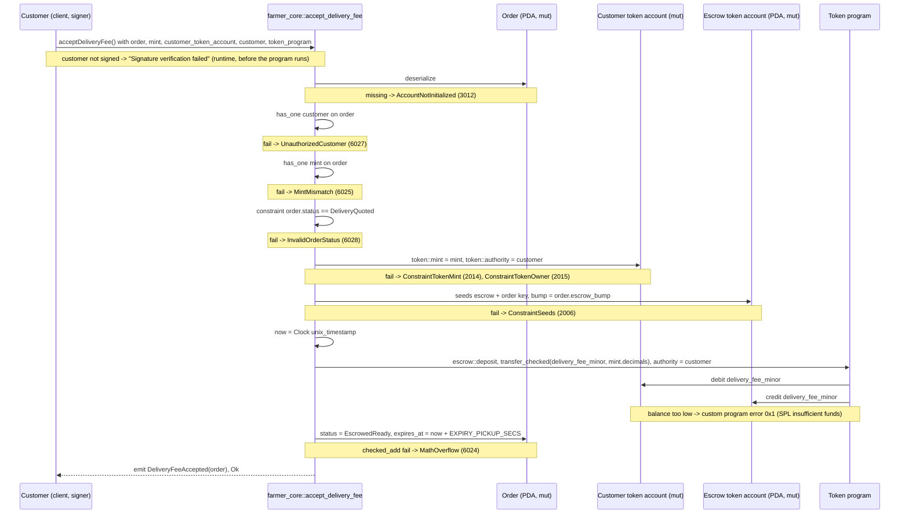

# accept_delivery_fee

## Purpose

The order's customer signs to accept the delivery fee the warehouse quoted. The instruction moves
`order.delivery_fee_minor` from the customer's token account into the order's escrow token account (one
`transfer_checked` CPI signed by the customer), flips `status` from `DeliveryQuoted` to `EscrowedReady`, resets
`expires_at` to now + 72 h and emits `DeliveryFeeAccepted`. It implements README.md section 8.5 "Customer accepts
delivery fee" (signer: customer; requires `status == DELIVERY_QUOTED`; transfer `delivery_fee_minor` customer ATA ->
escrow ATA; status -> `ESCROWED_READY`), the `DELIVERY_QUOTED -> ESCROWED_READY` step of section 6, the "customer must
approve (escrow additional fee)" rule of section 7 and the escrow balance rule of section 5.8 (delivery:
`subtotal_minor`, then `+ delivery_fee_minor` after acceptance).

## Lifecycle

There are no arguments and no `require!`: every gate is an account constraint, the amount is read from the order,
and the handler only runs the CPI, writes two fields and emits.

## Components

| Instruction | Signer | Accounts (name, role, client resolution) | Args | Events |
|---|---|---|---|---|
| `accept_delivery_fee` | `customer` (wallet; the order's customer, pays no rent) | `order` (mut, status gate + source of `customer`, `mint`, `delivery_fee_minor`, `escrow_bump`; must pass), `mint` (read, decimals for `transfer_checked`; must pass, checked by `has_one` on `order`), `customer_token_account` (mut, debited; must pass, the customer's ATA), `escrow` (mut, credited; auto from IDL, seeds from `order`), `customer` (signer; must pass via `.accountsPartial` + `.signers`), `token_program` (must pass, `TOKEN_PROGRAM_ID` in tests) | none | `DeliveryFeeAccepted { order }` |

Handler: `programs/farmer-core/src/instructions/accept_delivery_fee.rs`; CPI: `escrow::deposit` in
`programs/farmer-core/src/escrow.rs`; wrapper: `farmer_core::accept_delivery_fee` in `programs/farmer-core/src/lib.rs`.

## Data model

Mutated: `Order` (seeds `["order", offer, customer, order_id u64 LE]`, 8 + INIT_SPACE = 227 bytes). Two fields are
written: `status` `DeliveryQuoted -> EscrowedReady` and `expires_at = now + EXPIRY_PICKUP_SECS` (72 h, replacing the
6 h quote window set by `quote_delivery_fee`). `delivery_fee_minor` is read, never written here.

Token balances: `delivery_fee_minor` moves from `customer_token_account` to the escrow token account (a plain SPL
token account at PDA `["escrow", order]`, 165 bytes, its own authority, created and funded with `subtotal_minor` by
`create_order`). Afterwards the escrow holds `subtotal_minor + delivery_fee_minor` (test: `SUBTOTAL + 500_000`); a
zero fee leaves both balances unchanged.

Read: `Mint` (`decimals`), `customer_token_account` (`mint`, `owner`). Not touched: `ProgramConfig`, `LotOffer`,
`Warehouse`, `WarehouseCustomer`.

## Design decisions

- **No args; the fee comes from the account.** `order.delivery_fee_minor` was written by `quote_delivery_fee`, so the
  customer can only accept the amount that was quoted (README 8.5).
- **`has_one = customer` on the signer**, no `CustomerProfile` / `WarehouseCustomer` lookup: the order already stores
  the buyer and eligibility was checked at `create_order`. A different confirmed customer gets `UnauthorizedCustomer`
  (test "rejects a signer that is not the order's customer").
- **`has_one = mint` plus `token::mint = mint`** bind the passed `Mint` to `order.mint` and the customer's token
  account to that mint, so `transfer_checked` runs with the order's mint and decimals (README 5.8: `mint` is copied
  into the order because `transfer_checked` needs it).
- **Escrow trusted by seeds and the stored bump.** `bump = order.escrow_bump` skips re-derivation (README 5.8); the
  account was created by `create_order` with `token::mint = mint, token::authority = escrow, token::token_program =
  token_program`, so no `token::` constraint is repeated here.
- **Deposit signed by the customer, not the PDA.** `escrow::deposit` uses `CpiContext::new` with `customer` as
  authority; the program signs only withdrawals (`reject_delivery_fee`, `refuse_delivery`), per AGENTS.md "escrow.rs".
- **Exact status gate as a constraint.** Only `DeliveryQuoted` passes (README 12 "Delivery quote/acceptance states
  enforced exactly"); a `PendingDeliveryQuote` order returns `InvalidOrderStatus` (test "rejects an order that was
  not quoted").
- **`expires_at` reset, never checked.** `EscrowedReady` reuses `EXPIRY_PICKUP_SECS` (comment in `states.rs`, README
  8.7 note); an order whose 6 h quote window already passed can still be accepted until `expire_order` (M6) exists.
- **No pause gate.** None of quote / accept / reject / refuse load `config`: they finish an order that was created
  under the pause gate.
- **Zero fee is valid.** `quote_delivery_fee` allows 0 and `transfer_checked(0)` succeeds (test "accepts a zero
  fee"); the transition still has to run for the order to become ready.

## Source

- `programs/farmer-core/src/instructions/accept_delivery_fee.rs`
- `programs/farmer-core/src/escrow.rs`
- `programs/farmer-core/src/states.rs`
- `programs/farmer-core/src/errors.rs`
- `programs/farmer-core/src/events.rs`
- `programs/farmer-core/src/lib.rs`
- `tests/accept_delivery_fee.ts`
- `tests/helpers.ts`
- `tests/flow_order.ts`
