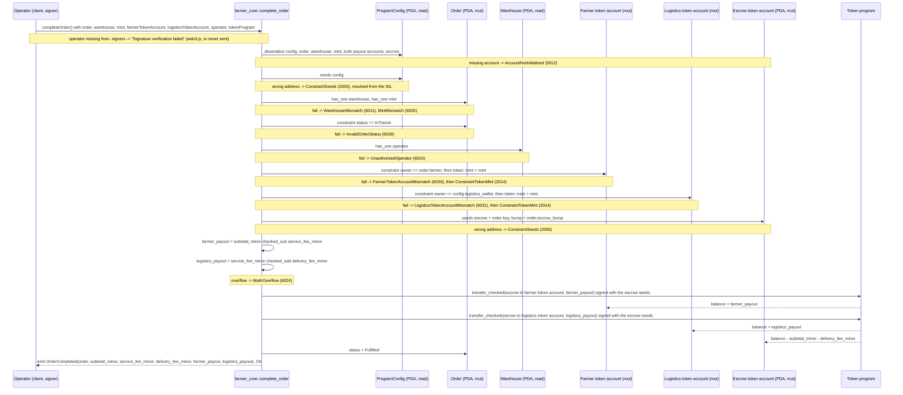

# complete_order

## Purpose

The warehouse operator signs to complete an order that is `InTransit`. The instruction releases the escrow in two
`transfer_checked` CPIs signed by the program: `subtotal_minor - service_fee_minor` to a token account owned by
`order.farmer`, `service_fee_minor + delivery_fee_minor` to a token account owned by `config.logistics_wallet`; then
it sets the order to `Fulfilled` and emits `OrderCompleted`. It implements README.md section 8.6 "Warehouse completes
order (releases escrow)", the section 6 rules "`FULFILLED` can only be reached from `IN_TRANSIT`" and "Warehouse
controls `IN_TRANSIT` and `FULFILLED`", the section 7 payout formulas (fees to `logistics_wallet`, `farmer_payout =
subtotal_minor - service_fee_minor`) and the section 12 rules (operator match for completion, "Escrow release only from
`IN_TRANSIT`").

## Lifecycle

Every gate is an `#[account]` constraint; the handler has no `require!`. Both CPIs run before the status write.

## Components

| Instruction | Signer | Accounts (name, role, client resolution) | Args | Events |
|---|---|---|---|---|
| `complete_order` | `operator` (the `warehouse.operator` wallet; not `mut`, no lamports move; the provider wallet pays the tx fee in tests) | `config` (read, source of `logistics_wallet`; auto from IDL, const seeds), `order` (mut, status gate + source of `farmer`, amounts, `escrow_bump`; must pass), `warehouse` (read, operator gate; must pass), `mint` (read, `transfer_checked` decimals; must pass), `farmer_token_account` (mut, payout owned by `order.farmer`; must pass), `logistics_token_account` (mut, payout owned by `config.logistics_wallet`; must pass), `escrow` (mut, source of both payouts; auto from IDL, seeds from `order`), `operator` (signer; `.accountsPartial` + `.signers`), `token_program` (must pass, `TOKEN_PROGRAM_ID` in tests) | none | `OrderCompleted { order, subtotal_minor, service_fee_minor, delivery_fee_minor, farmer_payout, logistics_payout }` |

Handler `instructions/complete_order.rs`; both CPIs through `escrow::withdraw` (`escrow.rs`); wrapper `farmer_core::complete_order` (`lib.rs`).

## Data model

Mutated: `Order` (seeds `["order", offer, customer, order_id u64 LE]`, 8 + INIT_SPACE = 227 bytes): only `status` changes,
`InTransit -> Fulfilled`; `expires_at` and every other field keep their values (no new expiry window). Read from the order:
`farmer`, `warehouse`, `mint`, `subtotal_minor`, `service_fee_minor`, `delivery_fee_minor`, `escrow_bump`.

Token balances (escrow token account at `["escrow", order]`, its own authority):

| Destination | Amount | Test (`SUBTOTAL` 10_000_000, `SERVICE_FEE` 250_000) |
|---|---|---|
| `farmer_token_account` | `subtotal_minor - service_fee_minor` | +9_750_000 (pickup and delivery); +10_000_000 with a `fee_bps` 0 warehouse |
| `logistics_token_account` | `service_fee_minor + delivery_fee_minor` | +250_000 (pickup); +750_000 with a 500_000 fee; unchanged with `fee_bps` 0 on a pickup |
| escrow | `-(subtotal_minor + delivery_fee_minor)` | 0 after completion (asserted by the pickup, delivery and flow tests; the `fee_bps` 0 test does not read it) |

The escrow account stays open with its rent (nothing is created or closed); any balance above `subtotal_minor +
delivery_fee_minor` stays in it. Read: `ProgramConfig` (`logistics_wallet` only; `paused` is not checked), `Warehouse`
(`operator`), `Mint` (`decimals`). Not touched: `LotOffer` (stock reserved at `create_order` is not restored by a sale),
`WarehouseCustomer`, `FarmerProfile`, `CustomerProfile`.

## Design decisions

- **Operator gate through the order's warehouse.** `order has_one = warehouse` plus `warehouse has_one = operator`:
  only the operator of the warehouse stored in the order can complete (README 12 "completion"). Verified by "rejects
  a signer that is not the warehouse operator".
- **Single accepted status, `InTransit`.** README 6 "`FULFILLED` can only be reached from `IN_TRANSIT`" and README 12
  "Escrow release only from `IN_TRANSIT`". `EscrowedReady` is rejected ("rejects an order that is not in transit") and
  so is a second completion ("rejects an order already fulfilled"), so the escrow cannot be released twice.
- **Payouts computed from the order, not from `escrow.amount`.** The split is deterministic from `subtotal_minor`,
  `service_fee_minor` (fixed at creation) and `delivery_fee_minor`; anything sent to the escrow on top stays there (the
  `escrow.amount` rule of AGENTS.md "escrow.rs" is for refunds). `checked_sub` / `checked_add` map an impossible
  overflow to `MathOverflow` (AGENTS.md "Checked arithmetic, named errors").
- **Operator picks the destinations, owner checks keep the money with the payees.** Neither payee signs, so
  `token::authority` is unavailable; `constraint = owner == order.farmer` / `owner == config.logistics_wallet`, both
  with `token::mint = mint`, accept any token account of the order's mint owned by the right wallet (not only the ATA).
- **Two distinct destination errors.** `FarmerTokenAccountMismatch` (6030) and `LogisticsTokenAccountMismatch` (6031)
  form a `// ---- Payout` section appended to `FarmerCoreError` (codes never shift); one test each.
- **Logistics destination validated against `config.logistics_wallet` at completion time.** The order never stores
  the logistics wallet; `config` is loaded read-only (const seeds, resolved by the client from the IDL) so the
  current wallet is the authority (README 7 "paid to `logistics_wallet`").
- **Payout accounts must already exist.** The program does not create ATAs: no associated-token program, no payer,
  no rent in this instruction. A missing account fails with `AccountNotInitialized`; clients prepend
  `createAssociatedTokenAccountIdempotent` when needed (the tests call `ataOf(owner)` first).
- **Zero amounts still go through the CPI.** No branch on `farmer_payout` or `logistics_payout`; the `fee_bps` 0
  pickup test proves a `transfer_checked` of 0 to the logistics account succeeds and leaves its balance unchanged.
- **Program signs with the stored bump.** Both `withdraw` calls sign with `[SEED_ESCROW, order, order.escrow_bump]`;
  `transfer_checked` needs `mint.decimals`, hence `mint` as an account pinned by `has_one` (README 5.8).
- **No pause gate, no expiry check, escrow not closed.** `config.paused` is not read (the gate stays on `publish_offer`
  and `create_order`, AGENTS.md "Validation Rules"); transitions never read `expires_at` (`expire_order`, M6); M6 will
  also close escrows and return rent to the customer on every terminal path, so the emptied token account remains.
- **Event carries every amount.** `OrderCompleted` (README 9) lets the indexer and katubaya's inventory reconciliation record the sale without fetching the order.

## Source

- `programs/farmer-core/src/instructions/complete_order.rs`
- `programs/farmer-core/src/escrow.rs`
- `programs/farmer-core/src/states.rs`
- `programs/farmer-core/src/errors.rs`
- `programs/farmer-core/src/events.rs`
- `programs/farmer-core/src/lib.rs`
- `tests/complete_order.ts`
- `tests/helpers.ts`
- `tests/flow_order.ts`
