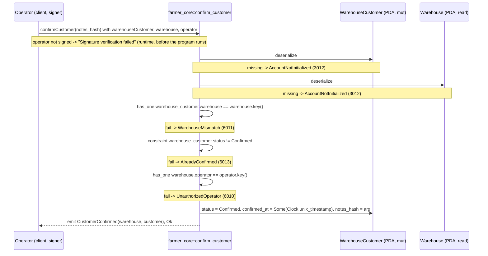

# confirm_customer

## Purpose

The warehouse operator signs to confirm a customer for their warehouse. `request_customer_confirmation`
creates the `WarehouseCustomer` PDA as `Pending` (the request); this instruction sets `status = Confirmed`,
stamps `confirmed_at` from the cluster clock, stores the optional `notes_hash` and emits `CustomerConfirmed`.
It implements README.md section 8.3 step 2 (signer: `warehouse.operator`; off-chain address collection
already done; sets `CONFIRMED`) on the account of section 5.5, whose `CONFIRMED` status is the eligibility
check for ordering. It also re-admits a `Revoked` customer: the only blocked input state is `Confirmed`.

## Lifecycle

There are no `require!` checks: all gates are account constraints. The handler writes three fields and emits.

## Components

| Instruction | Signer | Accounts (name, role, client resolution) | Args | Events |
|---|---|---|---|---|
| `confirm_customer` | `operator` (must equal `warehouse.operator`) | `warehouse_customer` (mut, the relation being confirmed; must pass `wcustomerPDA(warehouse, customer)`), `warehouse` (read, authorizes the signer; must pass), `operator` (signer; must pass + `.signers`) | `notes_hash: Option<[u8; 32]>` | `CustomerConfirmed { warehouse, customer }` |

Handler: `programs/farmer-core/src/instructions/confirm_customer.rs`; wrapper:
`farmer_core::confirm_customer` in `programs/farmer-core/src/lib.rs`.

## Data model

Mutated: `WarehouseCustomer` (seeds `["wcustomer", warehouse_pubkey, customer_pubkey]`, 8 + INIT_SPACE = 115 bytes).
Fields: `warehouse: Pubkey`, `customer: Pubkey`, `status: WarehouseCustomerStatus`, `confirmed_at: Option<i64>`,
`notes_hash: Option<[u8; 32]>`. This instruction writes `status`, `confirmed_at` and `notes_hash`; `warehouse` and
`customer` are untouched.

Transition: `Pending -> Confirmed` and `Revoked -> Confirmed`; `Confirmed -> Confirmed` is rejected
(`AlreadyConfirmed`). `confirmed_at` is restamped and `notes_hash` overwritten on every successful call,
including re-admission. The sibling `revoke_customer` leaves both fields as history when it sets `Revoked`.

Read: `Warehouse` (seeds `["warehouse", warehouse_id u64 LE]`, 8 + INIT_SPACE = 1367 bytes), used for its
`operator` field (via `has_one`) and its key (compared with `warehouse_customer.warehouse`).

Not touched: `ProgramConfig`, `CustomerProfile`. No pause or admin gate.

## Design decisions

- **Gates as constraints, no `require!`.** `WarehouseMismatch`, `AlreadyConfirmed` and `UnauthorizedOperator`
  are declared on the accounts they protect (AGENTS.md "Gates as constraints"); the handler is three writes
  and an `emit!`.
- **Not idempotent.** Unlike `set_farmer_warehouse`, a second confirm fails with `AlreadyConfirmed`: the
  handler overwrites `confirmed_at` and `notes_hash` and re-emits the indexer event, so a silent repeat
  would rewrite history. Verified by "rejects an already confirmed customer".
- **`Revoked -> Confirmed` is allowed.** The constraint is `status != Confirmed`, not `== Pending`.
  `request_customer_confirmation` is `init`-only (one PDA per warehouse+customer pair, no re-request), so
  re-admission has to go through confirm. Verified by "re-admits a revoked customer".
- **`confirmed_at` comes from `Clock::get()`, not from an argument.** The operator cannot backdate the
  confirmation; the test asserts the stamp is within the transaction's wall-clock window.
- **`notes_hash` is optional and always written.** `None` clears a previous hash. It is a hash of the
  off-chain record (README 5.5: never PII), so the on-chain account carries no address data.
- **README's `(warehouse, customer)` args became the `warehouse_customer` account.** Both keys are read
  from the account; the event payload uses them, and `has_one = warehouse` ties the account to the passed
  warehouse.
- **`warehouse_customer` is not re-derived from seeds.** Its seeds include the customer key, which is
  not an account here; the type check plus `has_one = warehouse` suffice, and the client passes the
  address (`wcustomerPDA`).

## Source

- `programs/farmer-core/src/instructions/confirm_customer.rs`
- `programs/farmer-core/src/states.rs`
- `programs/farmer-core/src/errors.rs`
- `programs/farmer-core/src/events.rs`
- `programs/farmer-core/src/lib.rs`
- `tests/confirm_customer.ts`
- `tests/helpers.ts`
