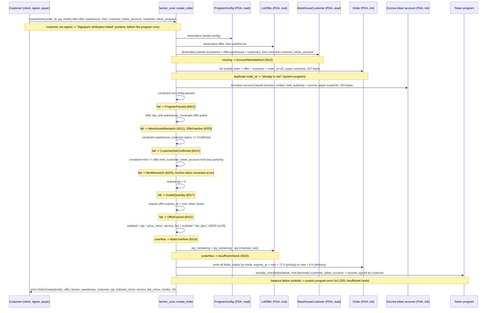

# create_order

## Purpose

A confirmed customer signs to buy `qty` units of an active offer. In one transaction the instruction creates the
`Order` PDA keyed by offer + customer + an explicit `order_id`, creates the escrow token account (a PDA that is its own
authority), reserves stock (`offer.qty_remaining -= qty`), fixes `service_fee_minor` from the warehouse `fee_bps`,
transfers `subtotal = qty * price_minor` from the customer's token account into the escrow and emits `OrderCreated`.
It implements README.md section 8.5 "Create order" (signer: customer; checks: not paused, offer active, stock,
`WarehouseCustomer` confirmed; reserve stock immediately; escrow the subtotal; status by mode) on the accounts of
section 5.8, the fee formula of section 7, the first state of each lifecycle in section 6 and the "stock reservation
correctness" rule of section 12. The mint allowlist is not re-checked here (section 12: enforced once at `publish_offer`).

## Lifecycle

The two `init`s and the account constraints run before any `require!`; the handler then validates `qty` and the offer
expiry, does the arithmetic, writes the `Order`, deposits and emits. The token CPI is the last state change, so an
SPL failure rolls back the stock decrement with the rest of the transaction.

## Components

| Instruction | Signer | Accounts (name, role, client resolution) | Args | Events |
|---|---|---|---|---|
| `create_order` | `customer` (wallet; pays rent of `order` and `escrow`, signs the deposit) | `config` (read, pause gate; auto, const seeds), `offer` (mut, stock + price + mint + warehouse; must pass), `warehouse` (read, `fee_bps`; passed by the test, IDL relation `offer`), `warehouse_customer` (read, confirmation gate; auto, seeds from `offer.warehouse` + `customer`, the TS resolver fetches the offer), `order` (init; auto, seeds from `offer` + `customer` + `order_id` arg), `mint` (read, decimals + `MintMismatch`; must pass), `customer_token_account` (mut, source of funds; must pass), `escrow` (init token account; auto, seeds from `order`), `customer` (signer, mut payer; `.accountsPartial` + `.signers`), `token_program` (must pass, an `Interface` is not auto-resolved), `system_program` (auto) | `order_id: u64`, `qty: u64`, `mode: FulfillmentMode` | `OrderCreated { order, offer, farmer, warehouse, customer, qty, subtotal_minor, service_fee_minor, mode }` |

Handler: `programs/farmer-core/src/instructions/create_order.rs`; token CPI: `escrow::deposit` in
`programs/farmer-core/src/escrow.rs`; wrapper: `farmer_core::create_order` in `programs/farmer-core/src/lib.rs`.

## Data model

Created: `Order` (seeds `["order", offer_pubkey, customer_pubkey, order_id u64 LE]`, 8 + INIT_SPACE = 227 bytes). All fifteen
fields are written: `order_id`, `qty`, `fulfillment_mode` from the args; `offer`, `farmer`, `warehouse` copied from the
`LotOffer` (`farmer` is the farmer's wallet, as stored in the offer); `customer` = the signer; `mint` = the `mint` account
(equal to `offer.mint` by constraint); `subtotal_minor` = `qty * price_minor`; `service_fee_minor` = `subtotal * fee_bps / 10_000`;
`delivery_fee_minor` = 0; `status` = `EscrowedPickup` (pickup) or `PendingDeliveryQuote` (delivery); `created_at` = cluster
clock; `expires_at` = `created_at` + `EXPIRY_PICKUP_SECS` (72 h) or + `EXPIRY_PENDING_QUOTE_SECS` (6 h); `escrow_bump` = the
escrow PDA bump.

Created: escrow token account (seeds `["escrow", order_pubkey]`, plain SPL token account, 165 bytes), `mint` = the offer's mint,
authority = itself. After the instruction it holds exactly `subtotal_minor`.

Mutated: `LotOffer.qty_remaining` decremented by `qty` (`checked_sub`). No other offer field changes.

Token balances: `subtotal_minor` moves from `customer_token_account` to the escrow, signed by the customer. The service fee is
only recorded; it is paid out of the escrowed subtotal at completion (README section 7). Rent for both new accounts is paid in
SOL by the customer; the escrow rent is not reclaimed on refund in M4 (no `close`).

Read: `ProgramConfig` (seeds `["config"]`) for `paused`; `Warehouse` for `fee_bps`; `WarehouseCustomer` (seeds
`["wcustomer", offer.warehouse, customer]`) for `status`; `Mint` for `decimals` and the `MintMismatch` check.

## Design decisions

- **Explicit `order_id`, no counter.** Seeds `["order", offer, customer, id]`: the same customer may order the same offer
  many times; a reused id fails at `init` with "already in use" (test "rejects a duplicate order_id").
- **Stock is reserved in the same transaction as the deposit** (README 8.5 and 12). `checked_sub` doubles as the stock
  check, so there is no separate compare and `InsufficientStock` is the only failure path.
- **`service_fee_minor` fixed at creation** (README 5.8 "for determinism"): a later `fee_bps` change cannot alter a live order.
  The product is done in `u128` so `subtotal * fee_bps` cannot overflow; the cast back to `u64` is safe because
  `fee_bps <= MAX_FEE_BPS` makes the fee at most the subtotal.
- **The escrow is a token account that is its own authority**, at `["escrow", order]`, and `escrow_bump` is stored on the
  order (README 5.8) so `reject_delivery_fee`, `refuse_delivery` and the M5 payout sign withdrawals without re-deriving.
- **`warehouse_customer` is derived from `offer.warehouse`, not from the `warehouse` account passed in:** a customer confirmed
  by another warehouse cannot buy here, whatever accounts the client supplies. `warehouse` is loaded only for `fee_bps` and
  tied to the offer by `has_one` (`WarehouseMismatch`, reused from the Farmer section).
- **`mint` is an account, constrained to `offer.mint`, and copied into the order** because `transfer_checked` needs the mint and
  its decimals (README 5.8). The allowlist is not re-checked: `publish_offer` enforced it once (README 12).
- **`transfer_checked` through `token_interface`** so SPL Token and Token-2022 both work (README 11); the tests use classic
  SPL Token only.
- **Customer pays rent for both accounts** (`payer = customer`); the escrow is created here even though a delivery order may
  still be canceled, so a canceled or refused order leaves a 165-byte account behind in M4.
- **Delivery orders start at `PendingDeliveryQuote` with `delivery_fee_minor = 0`** and the short 6 h window; pickup orders are
  immediately `EscrowedPickup` with 72 h. `expires_at` is stored but not enforced until `expire_order` (M6).
- **`require!` only on `qty` and the offer expiry**, in handler order; both compare against values the constraints cannot
  see (an arg and the clock). `now` is read once and reused for `created_at` and `expires_at`.
- **Pause gate on `config`:** market instruction. The test pauses, asserts and unpauses in `finally` (singleton config).

## Source

- `programs/farmer-core/src/instructions/create_order.rs`
- `programs/farmer-core/src/escrow.rs`
- `programs/farmer-core/src/states.rs`
- `programs/farmer-core/src/errors.rs`
- `programs/farmer-core/src/events.rs`
- `programs/farmer-core/src/lib.rs`
- `tests/create_order.ts`
- `tests/helpers.ts`
- `tests/flow_order.ts`
