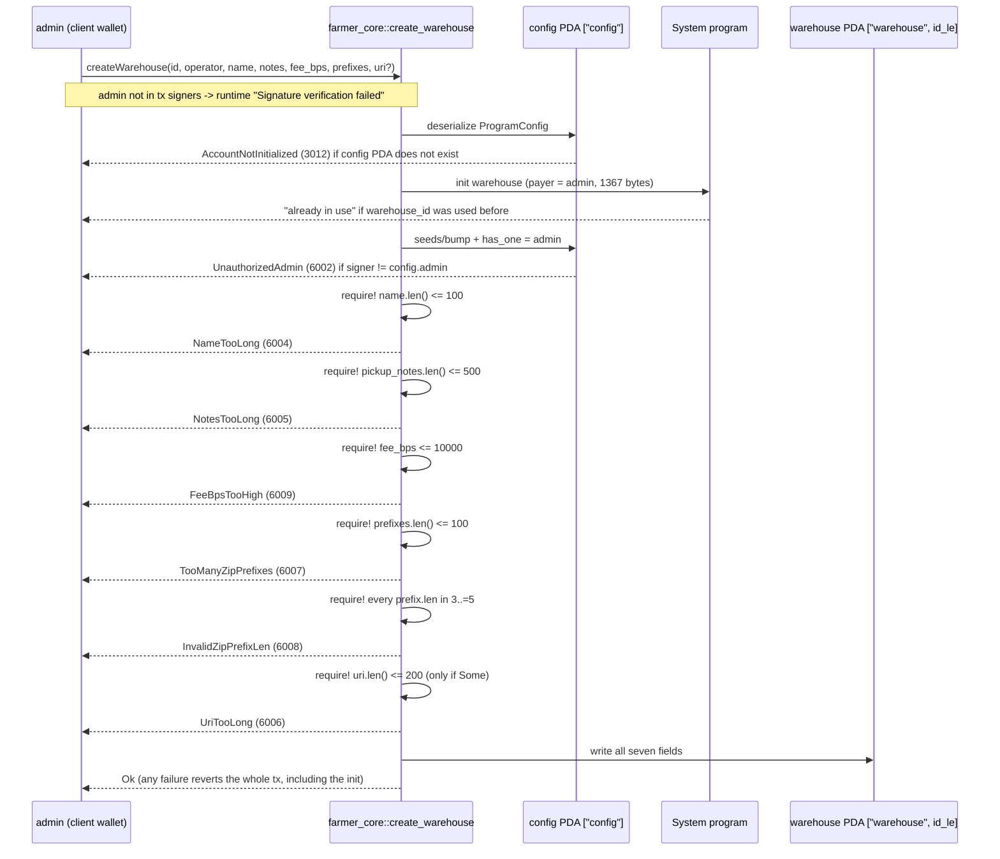

# create_warehouse

## Purpose

`config.admin` signs and pays to create one `Warehouse` PDA keyed by an explicit `warehouse_id`. The account stores the operator pubkey (the signer of every later warehouse action), pickup info, the service fee in basis points (README §7, `service_fee_minor = subtotal_minor * fee_bps / 10_000`) and the public zip coverage used only for UI discovery. It implements `create_warehouse(warehouse_id, operator, name, pickup_notes, fee_bps, deliver_zip_prefixes, delivery_fee_rules_uri?)` from README §8.1 and the `Warehouse` account of README §5.2.

## Lifecycle

Anchor runs `init` constraints before the access checks of the other accounts, so a duplicate id fails with "already in use" even when the signer is not the admin, and a non-admin with a fresh id fails only at `has_one`.

## Components

| instruction | signer | accounts | args | events |
|---|---|---|---|---|
| `create_warehouse` | `admin` (must equal `config.admin`; pays rent) | `config`: `ProgramConfig` PDA, read + `has_one` gate, auto from IDL. `warehouse`: `Warehouse` PDA, `init`, auto from IDL via the `warehouse_id` arg. `admin`: `Signer`, `mut`, defaults to the provider wallet (`.accountsPartial({ admin })` + `.signers([kp])` to override). `system_program`: auto. | `warehouse_id: u64`, `operator: Pubkey`, `name: String`, `pickup_notes: String`, `fee_bps: u16`, `deliver_zip_prefixes: Vec<ZipPrefix>`, `delivery_fee_rules_uri: Option<String>` | none (M1) |

Handler: `create_warehouse` in `programs/farmer-core/src/instructions/create_warehouse.rs`; entry point `farmer_core::create_warehouse` in `programs/farmer-core/src/lib.rs` forwards the args unchanged.

## Data model

Created: `Warehouse` (seeds `["warehouse", warehouse_id.to_le_bytes()]`, size 8 + INIT_SPACE = 1367 bytes).

| field | type | bound |
|---|---|---|
| `warehouse_id` | `u64` | from the arg, also in the seeds |
| `operator` | `Pubkey` | not validated; no account required for it |
| `name` | `String` | `MAX_NAME_LEN` = 100 bytes |
| `pickup_notes` | `String` | `MAX_NOTES_LEN` = 500 bytes |
| `fee_bps` | `u16` | `MAX_FEE_BPS` = 10000 |
| `delivery_fee_rules_uri` | `Option<String>` | `MAX_URI_LEN` = 200 bytes when `Some` |
| `deliver_zip_prefixes` | `Vec<ZipPrefix>` | `MAX_ZIP_PREFIXES` = 100 entries, each `{ prefix: u32, len: u8 }` with `len` in 3..=5 |

Read: `ProgramConfig` (seeds `["config"]`), only its `admin` field, through `has_one`.

## Design decisions

- **Explicit `warehouse_id`, no on-chain counter.** The client derives the PDA before sending, nothing serialises concurrent admins on a counter account, and a reused id is rejected for free by the System program at `init` ("already in use"). This is the repo-wide pattern (AGENTS.md "Initializing PDAs (explicit ids, no counters)").
- **Admin gate is a constraint, not handler code.** `has_one = admin @ UnauthorizedAdmin` on `config` fails before the handler runs and surfaces a named error in the IDL (AGENTS.md "Gates as constraints").
- **`operator` is a plain pubkey arg, not a signer.** The admin can provision a warehouse for an operator that has never touched the program; operator authority is enforced later by `has_one = operator` on the warehouse (`UnauthorizedOperator`).
- **Bounds re-checked with `require!` although `#[max_len]` already sizes the account.** Without them an oversize string fails at serialisation with an opaque error; with them each bound has its own code. Lengths are byte lengths (`String::len`), matching how `InitSpace` counts.
- **Zip prefix `len` validated on-chain even though prefixes are discovery-only** (README §5.2): a UI filter can trust that every stored prefix is 3, 4 or 5 digits.
- **Not idempotent and not gated by `config.paused`.** A second call with the same id fails at `init`; mutation is the job of `update_warehouse` (README §8.1, not yet implemented). The pause flag is set by the same admin that calls this, so a pause gate here would gate nobody.
- **`delivery_fee_rules_uri` stays `Option`.** README §5.2 marks the transparency doc optional; `None` is stored as-is and the URI bound is checked only when present.

## Source

- `programs/farmer-core/src/instructions/create_warehouse.rs`
- `programs/farmer-core/src/states.rs`
- `programs/farmer-core/src/errors.rs`
- `programs/farmer-core/src/lib.rs`
- `tests/create_warehouse.ts`
- `tests/helpers.ts`
