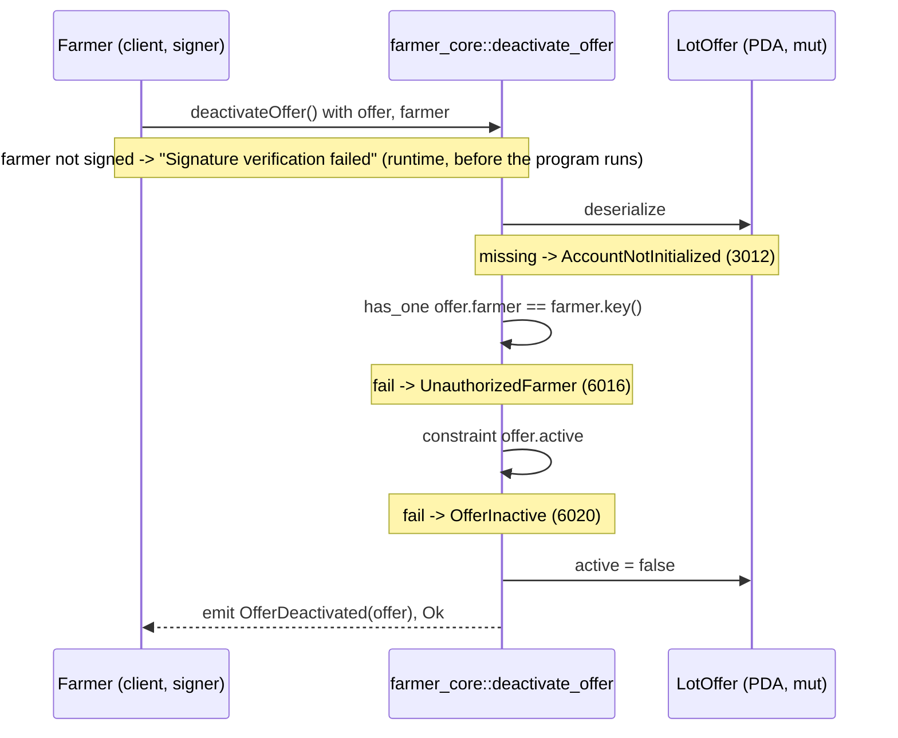

# deactivate_offer

## Purpose

The farmer who published a `LotOffer` signs to stop purchases on it. The instruction sets `active = false`
and emits `OfferDeactivated`. It implements README.md section 8.4 `deactivate_offer(offer_id)` ("stop
purchases") on the account of section 5.7; `active` is the flag README section 12 lists as a must-have check
("Offer active and sufficient quantity") for order creation in M4. There is no pause gate: deactivating is a
safety action, so it must work while the market is paused.

## Lifecycle

There are no `require!` checks and no arguments: both gates are account constraints. The handler writes one
field and emits.

## Components

| Instruction | Signer | Accounts (name, role, client resolution) | Args | Events |
|---|---|---|---|---|
| `deactivate_offer` | `farmer` (must equal `offer.farmer`, the wallet that published it) | `offer` (mut, the listing being closed; must pass `offerPDA(farmer, id)`, no `seeds` constraint here), `farmer` (signer; must pass + `.signers`) | none | `OfferDeactivated { offer }` |

Handler: `programs/farmer-core/src/instructions/deactivate_offer.rs`; wrapper:
`farmer_core::deactivate_offer` in `programs/farmer-core/src/lib.rs`.

## Data model

Mutated: `LotOffer` (seeds `["offer", farmer_pubkey, offer_id u64 LE]`, 8 + INIT_SPACE = 895 bytes), created
by `publish_offer` with `active = true`. Fields: `farmer`, `warehouse`, `offer_id`, `pack_ref`, `crop_name`,
`cultivar_name`, `unit_code`, `expires_at`, `notes_public`, `mint`, `price_minor`, `qty_remaining`, `active`,
`created_at`. This instruction writes `active` only; `qty_remaining` and every other field stay as published.

Transition: `active: true -> false`, once. Nothing sets `active` back to `true`; a farmer who wants to sell
again publishes a new offer under a new `offer_id`.

Read: nothing else. `ProgramConfig`, `FarmerProfile` and `Warehouse` are not accounts of this instruction, so
there is no pause gate, no approval gate and no operator involvement.

## Design decisions

- **Gates as constraints, no `require!`.** `UnauthorizedFarmer` (`has_one = farmer`) and `OfferInactive`
  (`constraint = offer.active`) are declared on the `offer` account (AGENTS.md "Gates as constraints"); the
  handler is one write and an `emit!`.
- **No `config.paused` gate.** Unlike `publish_offer`, the struct does not read `ProgramConfig`: stopping
  purchases is the action a farmer needs most during an incident, so it must not be blocked by the pause switch
  (doc comment on `DeactivateOffer`). This is a deliberate exemption from the AGENTS.md rule that market
  instructions carry `constraint = !config.paused`.
- **Not idempotent.** A second call fails with `OfferInactive` rather than silently succeeding: a repeat would
  emit a second `OfferDeactivated` for the indexer. Verified by "rejects an already inactive offer".
- **Farmer only, by wallet.** `LotOffer.farmer` stores the authority wallet (states.rs comment), so `has_one`
  compares it directly with the `Signer`; no `FarmerProfile` lookup. The warehouse operator and the admin
  cannot deactivate another party's offer in M3.
- **README's `offer_id` arg became the `offer` account.** The account is the identity; `has_one = farmer`
  ties it to the signer, so the id is not needed and the instruction has zero args.
- **`offer` is not re-derived from seeds.** Its seeds include `offer_id`, which is not an input here; the type
  check plus `has_one = farmer` suffice, and the client passes the address (`offerPDA`, returned by
  `publishOffer` in the tests).
- **`qty_remaining` is left untouched.** Only `active` gates ordering (README 12); the remaining stock stays
  readable as history and is not zeroed.

## Source

- `programs/farmer-core/src/instructions/deactivate_offer.rs`
- `programs/farmer-core/src/states.rs`
- `programs/farmer-core/src/errors.rs`
- `programs/farmer-core/src/events.rs`
- `programs/farmer-core/src/lib.rs`
- `tests/deactivate_offer.ts`
- `tests/helpers.ts`
