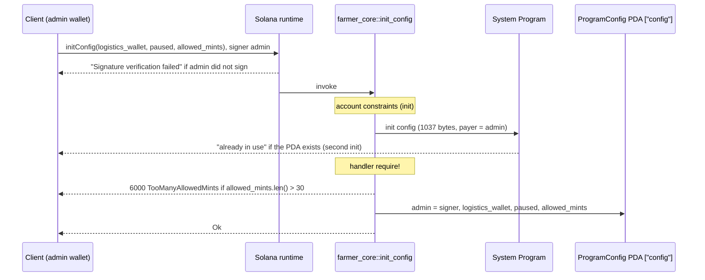

# init_config

## Purpose

Called once by the deployer. The signer (`admin`) pays for and creates the singleton `ProgramConfig` PDA (seeds `["config"]`) and stores itself as `admin`, together with the `logistics_wallet` that receives service and delivery fees (README section 7), the `paused` flag behind the program pause gate (README section 12), and the optional `allowed_mints` allowlist that `publish_offer` enforces later (README section 8.4). It implements `init_config(logistics_wallet, paused, allowed_mints?)` from README section 8.1 and the account in section 5.1.

## Lifecycle

## Components

| Instruction | Signer | Accounts | Args | Events |
|---|---|---|---|---|
| `init_config` | `admin` (also payer) | `config`: PDA created, resolved from IDL. `admin`: signer and payer, defaults to the provider wallet, override with `.accountsPartial({ admin })`. `system_program`: resolved from IDL | `logistics_wallet: Pubkey`, `paused: bool`, `allowed_mints: Vec<Pubkey>` | none |

Handler: `InitConfig` and `init_config` in `programs/farmer-core/src/instructions/init_config.rs`; wrapper: `farmer_core::init_config` in `programs/farmer-core/src/lib.rs`.

## Data model

Creates `ProgramConfig` (`programs/farmer-core/src/states.rs`):

| Field | Type | Set from |
|---|---|---|
| `admin` | `Pubkey` | `ctx.accounts.admin.key()` |
| `logistics_wallet` | `Pubkey` | arg |
| `paused` | `bool` | arg |
| `allowed_mints` | `Vec<Pubkey>`, `#[max_len(MAX_ALLOWED_MINTS)]` (30) | arg |

Seeds `[SEED_CONFIG]` = `["config"]`, canonical bump. Size `8 + ProgramConfig::INIT_SPACE` = 8 + 32 + 32 + 1 + (4 + 30 * 32) = 1037 bytes. Reads no other program account.

## Design decisions

- **Singleton PDA on a constant seed.** One config per program, so every later instruction resolves it from the IDL without an address argument. `init` makes any second call fail at account creation ("already in use"), so no `initialized` flag is needed and the instruction is deliberately not re-runnable; there is no `update_config` in `lib.rs`.
- **No admin precondition; the signer becomes admin.** Nothing exists on chain to gate against before the config does. The deployer must call `init_config` right after deploy, since the first successful caller holds the admin role.
- **Gate as constraint, bound as `require!`.** The only account relationship (`admin` signs and pays) is `#[account(mut)] Signer`; the only arg bound (`allowed_mints.len() <= MAX_ALLOWED_MINTS`) is a `require!` in the handler, per `AGENTS.md` "Error Handling".
- **`MAX_ALLOWED_MINTS = 30` is a transaction limit, not an account limit.** The 1232 B transaction size, not rent, bounds the vector (comment in `states.rs`): 31 pubkeys plus message overhead do not fit, so `TooManyAllowedMints` is a defensive branch.
- **Allowlist stored here, enforced elsewhere.** Empty `allowed_mints` means "any mint that is a real mint account and carries no denied token extension"; the check runs once in `publish_offer` (`AGENTS.md` "Validation Rules", README 8.4). `init_config` only validates the length.
- **Rent is constant.** `space` is the full `INIT_SPACE` whatever the vector length, so the account never needs a realloc to grow the allowlist later.

## Source

- `programs/farmer-core/src/instructions/init_config.rs`
- `programs/farmer-core/src/states.rs`
- `programs/farmer-core/src/errors.rs`
- `programs/farmer-core/src/lib.rs`
- `tests/init_config.ts`
- `tests/helpers.ts`
