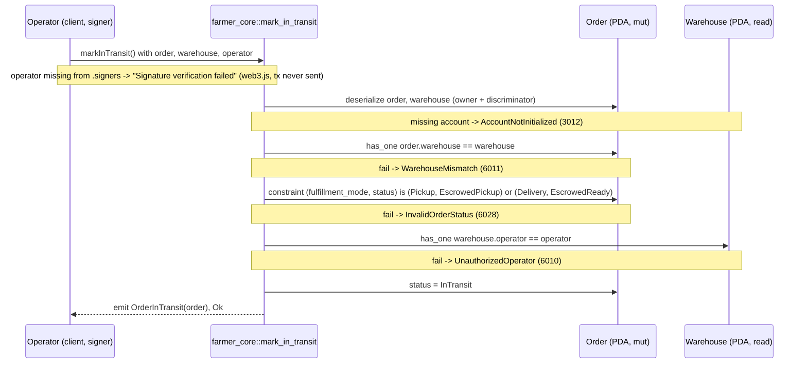

# mark_in_transit

## Purpose

The warehouse operator signs to lock an escrowed order for transport. The instruction checks that the order belongs
to the operator's warehouse and sits in the ready state of its mode (`EscrowedPickup` for pickup, `EscrowedReady`
for delivery), sets `status = InTransit` and emits `OrderInTransit`. It implements README.md section 8.6 "Warehouse
marks IN_TRANSIT (mandatory)" (signer `warehouse.operator`; pickup requires `ESCROWED_PICKUP`, delivery requires
`ESCROWED_READY`; status -> `IN_TRANSIT`), the `-> IN_TRANSIT` step of both transition chains in section 6
("Warehouse controls IN_TRANSIT and FULFILLED"; customer cancellation and warehouse refusal only before transport is
locked) and the section 12 rules that the operator must match `order.warehouse.operator` for in-transit and that the
escrow is released only from `IN_TRANSIT`. Section 7 is not involved: no tokens move until `complete_order`.

## Lifecycle

No `init`, no `config`, no token program: this instruction issues no CPI. Every gate is an `#[account]` constraint;
the handler has no `require!` and no arithmetic.

## Components

| Instruction | Signer | Accounts (name, role, client resolution) | Args | Events |
|---|---|---|---|---|
| `mark_in_transit` | `operator` (the `warehouse.operator` wallet; not `mut`, no lamports move; the provider wallet pays the tx fee in tests) | `order` (mut, mode + status gate, source of `warehouse`; must pass via `.accountsPartial`), `warehouse` (read, must equal `order.warehouse`, source of `operator`; passed explicitly, IDL `relations: ["order"]`), `operator` (signer, must equal `warehouse.operator`; `.accountsPartial` + `.signers`) | none | `OrderInTransit { order }` |

Handler: `programs/farmer-core/src/instructions/mark_in_transit.rs`; `escrow.rs` is not used (no token movement);
wrapper: `farmer_core::mark_in_transit` in `programs/farmer-core/src/lib.rs`.

## Data model

Mutated: `Order` (seeds `["order", offer, customer, order_id u64 LE]`, 8 + INIT_SPACE = 227 bytes), one field:
`status`, `EscrowedPickup -> InTransit` (pickup) or `EscrowedReady -> InTransit` (delivery). The other fourteen
fields are untouched; in particular `expires_at` keeps the 72 h window written by `create_order` (pickup) or
`accept_delivery_fee` (`EscrowedReady` reuses `EXPIRY_PICKUP_SECS`, `states.rs`): `InTransit` has no window of its own.

Token balances: none move. The escrow token account (`["escrow", order]`, its own authority) keeps `subtotal_minor`
(pickup) or `subtotal_minor + delivery_fee_minor` (delivery) until `complete_order` pays the farmer and the logistics
wallet; `tests/flow_order.ts` asserts the customer balance is still `start - SUBTOTAL - FEE` after completion.

Read: `Warehouse` (seeds `["warehouse", warehouse_id LE]`) for `operator`; `order.warehouse`,
`order.fulfillment_mode`, `order.status`. Not touched: `ProgramConfig`, `LotOffer` (stock stays reserved), mint,
escrow and token accounts.

## Design decisions

- **Mode and status checked as one pair.** README 8.6 states the requirement per mode, so a single `matches!` on
  `(fulfillment_mode, status)` accepts exactly `(Pickup, EscrowedPickup)` and `(Delivery, EscrowedReady)` and returns
  `InvalidOrderStatus` for everything else: a delivery order still pending or quoted (tests "still waiting for a
  quote", "whose quote was not accepted"), a second call (test "already in transit"). No `NotDeliveryOrder`: both
  modes are legal here.
- **Two `has_one` hops instead of a stored operator.** `Order` stores `warehouse`, not the operator, so the signer is
  checked through `order.warehouse -> warehouse.operator` (README 12 "operator must match order.warehouse.operator"
  for in-transit). `WarehouseMismatch` (6011, Farmer section) is reused for the wrong warehouse; codes never shift.
- **Status is the only write.** No `expires_at` reset: the three expiry constants in `states.rs` are one per waiting
  state (pending quote, quoted, pickup), and transport is not a state the customer waits on. No stock, fee or token
  field changes.
- **The lock is enforced by the other instructions' status gates.** Once `InTransit`, `refuse_delivery`
  (`PendingDeliveryQuote | DeliveryQuoted | EscrowedReady`) and `reject_delivery_fee` (`DeliveryQuoted`) return
  `InvalidOrderStatus` (test "blocks refuse_delivery and reject_delivery_fee once in transit"), and `complete_order`
  accepts only `InTransit` (`tests/complete_order.ts` "rejects an order that is not in transit"). README 6:
  `FULFILLED` only from `IN_TRANSIT`; README 12: escrow release only from `IN_TRANSIT`. The mandatory step can be
  neither skipped nor undone.
- **No pause gate.** `config` is not loaded: `config.paused` is checked on the market entries `publish_offer` and
  `create_order` (AGENTS.md "Validation Rules"); an already escrowed order can be shipped while paused.
- **No token CPI, no payer.** Nothing moves at this step (README 7: payouts happen on completion); `operator` is a
  plain `Signer`, no `mut`, no rent.
- **Minimal event.** `OrderInTransit { order }` (README 9): the indexer already holds the order from `OrderCreated`;
  the amounts arrive with `OrderCompleted`.

## Source

- `programs/farmer-core/src/instructions/mark_in_transit.rs`
- `programs/farmer-core/src/states.rs`
- `programs/farmer-core/src/errors.rs`
- `programs/farmer-core/src/events.rs`
- `programs/farmer-core/src/lib.rs`
- `tests/mark_in_transit.ts`
- `tests/helpers.ts`
- `tests/flow_order.ts`
