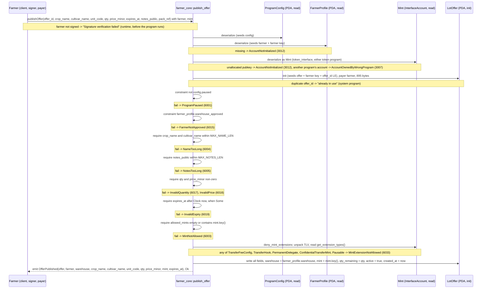

# publish_offer

## Purpose

An approved farmer signs to publish a transparent lot offer. The instruction creates the `LotOffer` PDA keyed by
the farmer's wallet and an explicit `offer_id`, copies the warehouse from the farmer's profile, stores the public
item, pricing and stock fields, sets `active = true`, stamps `created_at` from the cluster clock and emits
`OfferPublished`. It implements README.md section 8.4 (signer: farmer; requires `farmer.warehouse_approved`; the
mint is an **account**, not an argument; mint allowed when `config.allowed_mints` is empty or contains it, checked
here once; mint rejected if it carries a denied token extension) on the account of section 5.7, under the pause gate
and the "mint allowlist enforced once at `publish_offer`" rule of section 12, and the extension denylist of
section 11.

## Lifecycle

Account gates (the `mint` deserialization, `init`, pause, approval) run before any `require!`; the `require!` chain
validates the arguments in the handler order shown, then the mint's key against the allowlist and its extensions
against the denylist, then the handler writes the fourteen `LotOffer` fields and emits.

## Components

| Instruction | Signer | Accounts (name, role, client resolution) | Args | Events |
|---|---|---|---|---|
| `publish_offer` | `farmer` (wallet; also pays rent) | `config` (read, pause gate + allowlist; auto from IDL, const seeds), `farmer_profile` (read, approval gate + source of `warehouse`; auto, seeds from `farmer`), `offer` (init, the listing; auto, seeds from `farmer` + `offer_id` arg), `mint` (read, the payment mint and the source of `offer.mint`; the IDL carries no `pda`, `address` or `relations` for it, so the client must pass it), `farmer` (signer, mut payer; must pass via `.accountsPartial` + `.signers`), `system_program` (auto) | `offer_id: u64`, `crop_name: String`, `cultivar_name: Option<String>`, `unit_code: u16`, `qty: u64`, `price_minor: u64`, `expires_at: Option<i64>`, `notes_public: Option<String>`, `pack_ref: Option<Pubkey>` | `OfferPublished { offer, farmer, warehouse, crop_name, cultivar_name, unit_code, qty, price_minor, mint, expires_at }` |

Handler: `programs/farmer-core/src/instructions/publish_offer.rs`; wrapper:
`farmer_core::publish_offer` in `programs/farmer-core/src/lib.rs`.

## Data model

Created: `LotOffer` (seeds `["offer", farmer_pubkey, offer_id u64 LE]`, 8 + INIT_SPACE = 895 bytes). All fourteen fields are
written here; six are derived: `farmer` = the signer's wallet (not the `FarmerProfile` PDA), `warehouse` = `farmer_profile.warehouse`,
`mint` = `ctx.accounts.mint.key()`, `qty_remaining` = `qty`, `active` = true, `created_at` = cluster clock. The other eight
(`offer_id`, `pack_ref`, `crop_name`, `cultivar_name`, `unit_code`, `expires_at`, `notes_public`, `price_minor`) are the args as
given. `deactivate_offer` later flips `active`.

Read: `ProgramConfig` (seeds `["config"]`, 8 + INIT_SPACE = 1037 bytes) for `paused` and `allowed_mints`;
`FarmerProfile` (seeds `["farmer", farmer_pubkey]`, 8 + INIT_SPACE = 381 bytes) for `warehouse_approved` and
`warehouse`; the `mint` account for its key and its extension TLV (no address constraint, no seeds).

Not touched: `Warehouse` (its key comes from the profile), `CustomerProfile`, `WarehouseCustomer`.

## Design decisions

- **Explicit `offer_id`, no counter.** The client picks the id; it is an arg and a seed, so a duplicate fails at
  `init` with the system program's "already in use" (AGENTS.md "PDA Seeds"). Verified by "rejects a duplicate offer_id".
- **Seeds use the farmer's wallet, not the `FarmerProfile` PDA.** `LotOffer.farmer` is the authority, so
  `deactivate_offer` gates with `has_one = farmer` on the signer without loading the profile.
- **`farmer_profile` is re-derived from the signer** (`seeds = [SEED_FARMER, farmer.key()]`): a farmer cannot
  present someone else's approved profile. `FarmerNotApproved` is a constraint on it (AGENTS.md "Gates as constraints").
- **`warehouse` is copied from the profile, not an arg.** The offer belongs to the warehouse that approved the
  farmer; no `Warehouse` account is loaded.
- **The mint is an account, not an argument.** `InterfaceAccount<'info, Mint>` from `anchor_spl::token_interface`
  reaches both token programs and is what makes the two checks below possible: the program needs the mint's data,
  not just its key. A pubkey that is not a real mint now fails at deserialization — `AccountNotInitialized` (3012)
  when nothing is allocated there, `AccountOwnedByWrongProgram` (3007) when another program owns it — instead of
  being stored and only proven real at the first `transfer_checked` (test "rejects a pubkey that is not a mint
  account").
- **Mint allowlist enforced once, here.** `allowed_mints.is_empty() || contains(&mint.key())`; `create_order` (M4)
  trusts `offer.mint` (README 8.4 and 12). The empty-list branch accepts any real mint account that carries no
  denied extension, and is not covered by tests: the shared config is created with three mints and no instruction
  can change the list.
- **Five token extensions are denied,** by `deny_mint_extensions` right after the allowlist check: `TransferFeeConfig`,
  `TransferHook`, `PermanentDelegate`, `ConfidentialTransferMint`, `Pausable` (README 11). Each one would strand or
  endanger escrowed money: a transfer fee is withheld on the receiving account, so the escrow would hold less than
  the subtotal (breaking `complete_order`'s `escrow.amount - farmer_payout`) and `close_account` would fail with
  `AccountHasWithheldTransferFees`; a hook can block or re-route a transfer, and `transfer_checked` is issued without
  the hook's extra account metas; a permanent delegate can move tokens out of any account, the escrow included;
  non-zero confidential balances stop `close_account`; a pausable mint lets its authority freeze transfers while the
  escrow is funded.
- **The denylist is defence in depth behind the allowlist,** which is admin-curated and immutable after
  `init_config`: the guard catches an allowlisted mint that should not have been listed. Checking at publish time is
  enough because a mint's extensions are fixed when the mint is initialized. The test allowlists a transfer-fee mint
  on purpose and still gets `MintExtensionNotAllowed`.
- **Pause gate on `config`.** `publish_offer` is a market instruction (AGENTS.md "Validation Rules"). `set_paused`
  was added in M3 because nothing else could change `paused` after `init_config`, so the gate could never be
  exercised or operated; the test pauses, asserts `ProgramPaused` and unpauses in `finally` because `ProgramConfig`
  is a singleton shared by every test file.
- **`require!` only on args, in handler order:** names, notes, `qty`, `price_minor`, `expires_at`, then the mint's
  key and its extensions. Zero quantity or price would make an unsellable listing; `expires_at` is compared with the
  same `Clock` value stored in `created_at`, so an offer cannot be published already expired.
- **`pack_ref` and `unit_code` are stored unvalidated.** `PackPointer` lands in M7 (comment in `states.rs`);
  `unit_code` is a client-side mapping (README section 10).
- **Farmer pays rent** (`payer = farmer`, `mut`): the listing is the farmer's account; the provider wallet is not involved.
- **No `update_offer_price` / `increase_offer_qty`.** README 8.4 lists them as optional; they are not implemented
  and not on the roadmap.

## Source

- `programs/farmer-core/src/instructions/publish_offer.rs`
- `programs/farmer-core/src/states.rs`
- `programs/farmer-core/src/errors.rs`
- `programs/farmer-core/src/events.rs`
- `programs/farmer-core/src/lib.rs`
- `tests/publish_offer.ts`
- `tests/helpers.ts`
