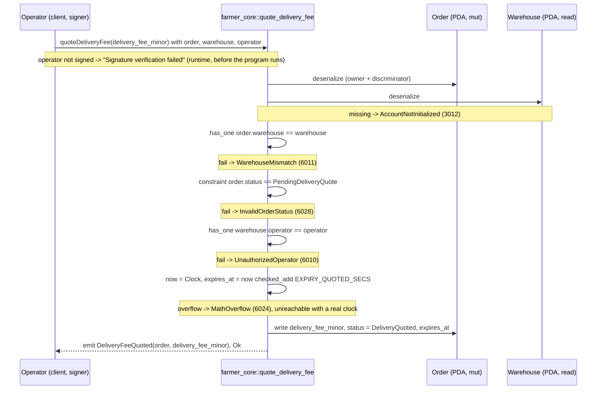

# quote_delivery_fee

## Purpose

The warehouse operator signs to price the delivery of an order created in `Delivery` mode. The instruction checks
that the order belongs to the operator's warehouse and still waits for a quote, stores `delivery_fee_minor`, moves
the order to `DeliveryQuoted`, restarts its expiry (now + 6 h) and emits `DeliveryFeeQuoted`. It implements
README.md section 8.5 "Quote delivery fee" (signer `warehouse.operator`, requires `status == PENDING_DELIVERY_QUOTE`),
the `PENDING_DELIVERY_QUOTE -> DELIVERY_QUOTED` transition of section 6, the dynamic quote of section 7 ("Quoted by
warehouse after order creation", the customer then approves or rejects) and the section 12 rule that the operator
must match `order.warehouse.operator` for quoting. No tokens move: the fee is escrowed only when the customer calls
`accept_delivery_fee`.

## Lifecycle

No `init`, no `config`, no token program: this instruction issues no CPI. Every gate is an account constraint; the
handler has no `require!`.

## Components

| Instruction | Signer | Accounts (name, role, client resolution) | Args | Events |
|---|---|---|---|---|
| `quote_delivery_fee` | `operator` (warehouse operator wallet; not `mut`, pays nothing in-program) | `order` (mut, the delivery order; must pass via `.accountsPartial`), `warehouse` (read, must equal `order.warehouse`, source of `operator`; passed explicitly), `operator` (signer, must equal `warehouse.operator`; must pass via `.accountsPartial` + `.signers`) | `delivery_fee_minor: u64` | `DeliveryFeeQuoted { order, delivery_fee_minor }` |

Handler: `programs/farmer-core/src/instructions/quote_delivery_fee.rs`; `escrow.rs` is not used (no token
movement); wrapper: `farmer_core::quote_delivery_fee` in `programs/farmer-core/src/lib.rs`.

## Data model

Mutated: `Order` (seeds `["order", offer_pubkey, customer_pubkey, order_id u64 LE]`, 8 + INIT_SPACE = 227 bytes),
three fields: `delivery_fee_minor` = the arg (0 since `create_order`), `status` `PendingDeliveryQuote -> DeliveryQuoted`,
`expires_at` = cluster clock + `EXPIRY_QUOTED_SECS` (21 600 s, 6 h), replacing the 6 h pending-quote window set at
creation. The other twelve fields are untouched.

Token balances: none move. The escrow token account (`["escrow", order]`, plain SPL token account, 165 bytes) keeps
`subtotal_minor`. The fee is deposited by the customer in `accept_delivery_fee` (escrow then holds subtotal + fee)
or never, if the customer calls `reject_delivery_fee` (subtotal refunded, order `Canceled`). The operator can still
`refuse_delivery` from `DeliveryQuoted`.

Read: `Warehouse` (seeds `["warehouse", warehouse_id LE]`) for `operator` only. Not touched: `ProgramConfig`,
`LotOffer`, `WarehouseCustomer`, mint and token accounts.

## Design decisions

- **Two `has_one` hops instead of a stored operator.** `Order` stores `warehouse`, not the operator, so the signer is
  checked through `order.warehouse -> warehouse.operator` (README 12 "operator must match order.warehouse.operator").
  The current `warehouse.operator` is the authority; the order never copies it.
- **Status gate as a constraint on `order`** (`== PendingDeliveryQuote @ InvalidOrderStatus`, AGENTS.md "Gates as
  constraints"). It rejects pickup orders (`EscrowedPickup`) and a second quote on the same order alike; no
  `NotDeliveryOrder` check is needed because only delivery orders ever enter `PendingDeliveryQuote`. One quote per
  order: a fee cannot be revised (test "rejects an order that is already quoted").
- **`WarehouseMismatch` reused.** The variant exists since M1 (Farmer section, message "Farmer did not request this
  warehouse"); new variants are only appended at the end of `FarmerCoreError` (codes never shift), so code 6011 is
  raised for a warehouse that is not the order's.
- **Fee unbounded, zero allowed.** `delivery_fee_minor` has no `require!`: the customer's protection is
  `accept_delivery_fee` / `reject_delivery_fee`, not a program cap. Zero (free delivery) is accepted; not covered by
  tests.
- **Expiry restarted, not checked.** `expires_at` is rewritten to now + 6 h so the customer gets a full window to
  answer; the pending-quote deadline is not checked here, nor in any M4 transition, so a late quote succeeds. Only
  `expire_order` (M6) will act on `expires_at`. `checked_add` maps a clock overflow to `MathOverflow` (AGENTS.md
  "Checked arithmetic, named errors").
- **No pause gate.** `config` is not loaded: `config.paused` is checked on the market entries `publish_offer` and
  `create_order` (AGENTS.md "Validation Rules"); an order already escrowed can be quoted while paused.
- **No token CPI, no payer.** The fee is only recorded; the customer, not the operator, funds it at acceptance
  (README 7 "Customer must approve (escrow additional fee)"). `operator` is a plain `Signer`: no `mut`, no rent.
- **Event carries the fee.** `DeliveryFeeQuoted { order, delivery_fee_minor }` (README 9) lets the indexer show the
  quote without fetching the order.

## Source

- `programs/farmer-core/src/instructions/quote_delivery_fee.rs`
- `programs/farmer-core/src/states.rs`
- `programs/farmer-core/src/errors.rs`
- `programs/farmer-core/src/events.rs`
- `programs/farmer-core/src/lib.rs`
- `tests/quote_delivery_fee.ts`
- `tests/helpers.ts`
- `tests/flow_order.ts`
