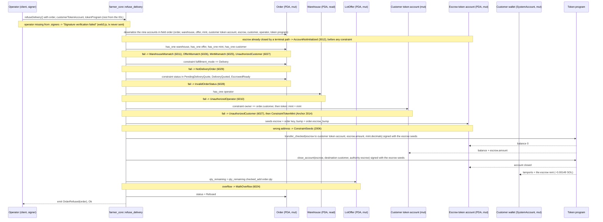

# refuse_delivery

## Purpose

The warehouse operator signs to refuse a delivery order before transit. The instruction refunds the whole escrow
balance (the subtotal, plus the delivery fee when the customer already accepted it) to a token account owned by the
order's customer, closes the emptied escrow token account and sends its rent back to the customer wallet, restores
`offer.qty_remaining`, sets the order to `Refused` and emits `OrderRefused`. It implements README.md section 8.5
"Warehouse refuses delivery" (signer: `warehouse.operator`; `order.mode == DELIVERY`; status in
`{PENDING_DELIVERY_QUOTE, DELIVERY_QUOTED, ESCROWED_READY}`; refund subtotal + any accepted fee; restore stock;
status `REFUSED`), the "warehouse can refuse delivery orders (pre-transit)" rule of section 6, the escrow layout of
section 5.8, the terminal-path escrow close of section 8.7 and the operator-match and stock-restoration checks of
section 12. Section 7 is not involved: nothing is paid to the farmer or the logistics wallet on a refusal.

## Lifecycle

Every gate is an `#[account]` constraint; the handler has no `require!`. Both token CPIs run before the state
writes, so a failed transfer or close leaves the order and the offer untouched.

## Components

| Instruction | Signer | Accounts (name, role, client resolution) | Args | Events |
|---|---|---|---|---|
| `refuse_delivery` | `operator` (the `warehouse.operator` wallet; not `mut`, no lamports move; the provider wallet pays the tx fee in tests) | `order` (mut, status gate + source of `customer`, `qty`, `escrow_bump`; must pass), `warehouse` (read, operator gate; IDL relation of `order`), `offer` (mut, stock restored; relation of `order`), `mint` (read, `transfer_checked` decimals; relation of `order`), `customer_token_account` (mut, refund destination owned by `order.customer`; operator picks it, must pass), `escrow` (mut, source of the refund, closed afterwards; `pda` in the IDL, seeds from `order`), `customer` (mut `SystemAccount`, escrow rent destination; relation of `order`), `operator` (signer; relation of `warehouse`, still needs `.signers`), `token_program` (must pass, `TOKEN_PROGRAM_ID` in tests) | none | `OrderRefused { order }` |

Only `order`, `customer_token_account` and `token_program` have to be passed: the Anchor TS client resolves
`warehouse`, `offer`, `mint` and `customer` from the fetched `order` and `operator` from the fetched `warehouse`
(`tests/refuse_delivery.ts` passes them explicitly anyway, through `.accountsPartial`).

Handler: `programs/farmer-core/src/instructions/refuse_delivery.rs`; token CPIs: `escrow::withdraw` and
`escrow::close` in `programs/farmer-core/src/escrow.rs`; wrapper: `farmer_core::refuse_delivery` in
`programs/farmer-core/src/lib.rs`.

## Data model

Mutated: `Order` (seeds `["order", offer, customer, order_id u64 LE]`, 8 + INIT_SPACE = 227 bytes): only `status`
changes, to `Refused`; `delivery_fee_minor` and `expires_at` keep the values of the previous state and no new expiry
window is set. `LotOffer`: `qty_remaining += order.qty` (checked). Escrow token account (seeds `["escrow", order]`,
165-byte SPL token account, its own authority): balance to 0, then closed. Customer token account: balance + the
escrow balance. Customer wallet: lamports + the escrow rent.

| Status at refusal | Escrow balance refunded |
|---|---|
| `PendingDeliveryQuote`, `DeliveryQuoted` | `subtotal_minor` (test: 10_000_000) |
| `EscrowedReady` | `subtotal_minor + delivery_fee_minor` (test: 10_000_000 + 500_000) |

Rent moves once: the escrow token account is closed and its rent-exempt lamports land on `order.customer`, who paid
them at `create_order`: ~0.00149 SOL, the rent-exempt minimum of a 165-byte token account. Read: `Warehouse` for
`operator`; `Mint` for `decimals`.
Not touched: `ProgramConfig` (no pause gate), `WarehouseCustomer`, `FarmerProfile`, `CustomerProfile`.

## Design decisions

- **Operator gate through the order's warehouse.** `order` has `has_one = warehouse` and `warehouse` has
  `has_one = operator`, so the signer must be the operator of the warehouse stored in the order (README 12: operator
  must match `order.warehouse.operator` for refusal). Verified by "rejects a signer that is not the warehouse operator".
- **Three accepted statuses via `matches!`.** README 8.5 lists `PENDING_DELIVERY_QUOTE`, `DELIVERY_QUOTED`,
  `ESCROWED_READY`; `InTransit` and the terminal states are excluded, so a refusal cannot undo a transport.
- **`NotDeliveryOrder` before `InvalidOrderStatus`.** A pickup order sits in `EscrowedPickup`, which also fails the
  status set; the mode constraint is declared first so the client gets the mode error (README 6: only delivery orders
  can be refused). The test "rejects a pickup order" depends on this order.
- **Operator picks the refund destination, owner check keeps the money with the customer.** The customer does not
  sign, so `token::authority = customer` (used by `reject_delivery_fee`) is impossible here; instead
  `constraint = customer_token_account.owner == order.customer` (evaluated first) plus `token::mint = mint` accepts
  any token account of the order's mint owned by the customer. Verified by "rejects a refund destination not owned by
  the customer".
- **Refund `escrow.amount`, not `subtotal + delivery_fee`.** One code path covers all three statuses and always
  moves the real balance (AGENTS.md "escrow.rs": refunds move `escrow.amount`, never a recomputed sum). It also
  leaves the escrow at exactly zero, which `close_account` requires.
- **Escrow closed, rent back to the customer.** README 8.7: every terminal path closes the escrow token account. The
  rent destination is a separate `customer: SystemAccount` pinned by `has_one = customer @ UnauthorizedCustomer` on
  the order, because the customer never signs a refusal; the test asserts the customer wallet grows by exactly the
  escrow's lamports. The escrow is its own authority, so `escrow::close` signs the CPI with
  `[SEED_ESCROW, order, order.escrow_bump]`, the same seeds as the withdrawal.
- **A replayed refusal fails on account resolution, not on the status gate.** Anchor deserializes every non-`init`
  account before running any constraint, and the closed escrow is the sixth account to deserialize, so a second
  refusal of the same order returns `AccountNotInitialized` (3012) instead of `InvalidOrderStatus` — asserted by
  "rejects a second refusal: the escrow is gone". The status constraint is still the gate whenever the escrow is
  alive: `tests/mark_in_transit.ts` "blocks refuse_delivery and reject_delivery_fee once in transit" refuses an
  `InTransit` order and gets `InvalidOrderStatus`.
- **Token-2022 transfer-fee mints are out of scope.** A mint with a transfer-fee extension withholds fees on the
  receiving account, so the escrow would hold less than the subtotal and `close_account` would fail with
  `AccountHasWithheldTransferFees`. The program does not inspect mint extensions; `config.allowed_mints`, set once
  at `init_config`, is the only control (README 11). Fee-less Token-2022 mints work: `tests/token2022.ts` drives a
  pickup order through the shared `escrow::withdraw` / `escrow::close` CPIs on a Token-2022 mint; no test refuses a
  delivery order on one.
- **Stock restored with `checked_add`.** README 12 "on any cancellation/refusal/expiry before completion, restore
  stock"; `MathOverflow` instead of a bare `+` (AGENTS.md "Checked arithmetic, named errors").
- **No pause gate.** `config` is not an account of this instruction, so a refund stays possible while the market is
  paused; among the order instructions only `create_order` (pause gate) and `complete_order` (which reads
  `config.logistics_wallet`) load `config`.
- **No expiry check.** Transitions never read `expires_at`; only `expire_order` does, and it accepts the same three
  statuses (plus `EscrowedPickup`). An order past its window can still be refused, and whichever of the two paths
  lands first closes the escrow and makes the other fail.

## Source

- `programs/farmer-core/src/instructions/refuse_delivery.rs`
- `programs/farmer-core/src/escrow.rs`
- `programs/farmer-core/src/states.rs`
- `programs/farmer-core/src/errors.rs`
- `programs/farmer-core/src/events.rs`
- `programs/farmer-core/src/lib.rs`
- `tests/refuse_delivery.ts`
- `tests/mark_in_transit.ts` (status gate with a live escrow)
- `tests/token2022.ts` (the shared escrow CPIs, close included, on a Token-2022 mint)
- `tests/helpers.ts`
