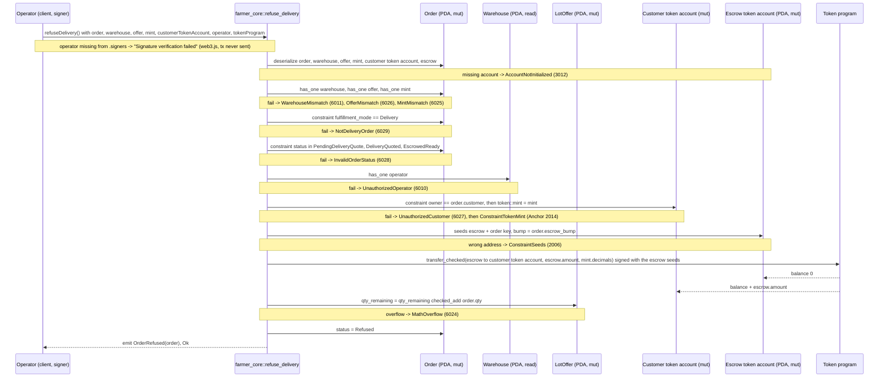

# refuse_delivery

## Purpose

The warehouse operator signs to refuse a delivery order before transit. The instruction refunds the whole escrow
balance (the subtotal, plus the delivery fee when the customer already accepted it) to a token account owned by the
order's customer, restores `offer.qty_remaining`, sets the order to `Refused` and emits `OrderRefused`. It implements
README.md section 8.5 "Warehouse refuses delivery" (signer: `warehouse.operator`; `order.mode == DELIVERY`; status in
`{PENDING_DELIVERY_QUOTE, DELIVERY_QUOTED, ESCROWED_READY}`; refund subtotal + any accepted fee; restore stock;
status `REFUSED`), the "warehouse can refuse delivery orders (pre-transit)" rule of section 6, the escrow layout of
section 5.8 and the operator-match and stock-restoration checks of section 12. Section 7 is not involved: nothing is
paid to the farmer or the logistics wallet on a refusal.

## Lifecycle

Every gate is an `#[account]` constraint; the handler has no `require!`. The withdraw CPI runs before the state
writes, so a failed transfer leaves the order, the offer and the escrow untouched.

## Components

| Instruction | Signer | Accounts (name, role, client resolution) | Args | Events |
|---|---|---|---|---|
| `refuse_delivery` | `operator` (the `warehouse.operator` wallet; not `mut`, no lamports move; the provider wallet pays the tx fee in tests) | `order` (mut, status gate + source of `customer`, `qty`, `escrow_bump`; must pass), `warehouse` (read, operator gate; must pass), `offer` (mut, stock restored; must pass), `mint` (read, `transfer_checked` decimals; must pass), `customer_token_account` (mut, refund destination owned by `order.customer`; operator picks it, must pass), `escrow` (mut, source of the refund; auto from IDL, seeds from `order`), `operator` (signer; `.accountsPartial` + `.signers`), `token_program` (must pass, `TOKEN_PROGRAM_ID` in tests) | none | `OrderRefused { order }` |

Handler: `programs/farmer-core/src/instructions/refuse_delivery.rs`; token CPI: `escrow::withdraw` in
`programs/farmer-core/src/escrow.rs`; wrapper: `farmer_core::refuse_delivery` in `programs/farmer-core/src/lib.rs`.

## Data model

Mutated: `Order` (seeds `["order", offer, customer, order_id u64 LE]`, 8 + INIT_SPACE = 227 bytes): only `status`
changes, to `Refused`; `delivery_fee_minor` and `expires_at` keep the values of the previous state and no new expiry
window is set. `LotOffer`: `qty_remaining += order.qty` (checked). Escrow token account (seeds `["escrow", order]`,
165-byte SPL token account, its own authority): balance to 0, account kept (not closed). Customer token account:
balance + the escrow balance.

| Status at refusal | Escrow balance refunded |
|---|---|
| `PendingDeliveryQuote`, `DeliveryQuoted` | `subtotal_minor` (test: 10_000_000) |
| `EscrowedReady` | `subtotal_minor + delivery_fee_minor` (test: 10_000_000 + 500_000) |

No rent moves: nothing is created or closed. Read: `Warehouse` for `operator`; `Mint` for `decimals`.
Not touched: `ProgramConfig` (no pause gate), `WarehouseCustomer`, `FarmerProfile`, `CustomerProfile`.

## Design decisions

- **Operator gate through the order's warehouse.** `order` has `has_one = warehouse` and `warehouse` has
  `has_one = operator`, so the signer must be the operator of the warehouse stored in the order (README 12: operator
  must match `order.warehouse.operator` for refusal). Verified by "rejects a signer that is not the warehouse operator".
- **Three accepted statuses via `matches!`.** README 8.5 lists `PENDING_DELIVERY_QUOTE`, `DELIVERY_QUOTED`,
  `ESCROWED_READY`; `InTransit` (M5) and the terminal states are excluded, so a refusal cannot undo a transport and
  cannot run twice ("rejects an order that is already refused").
- **`NotDeliveryOrder` before `InvalidOrderStatus`.** A pickup order sits in `EscrowedPickup`, which also fails the
  status set; the mode constraint is declared first so the client gets the mode error (README 6: only delivery orders
  can be refused). The test "rejects a pickup order" depends on this order.
- **Operator picks the refund destination, owner check keeps the money with the customer.** The customer does not
  sign, so `token::authority = customer` (used by `reject_delivery_fee`) is impossible here; instead
  `constraint = customer_token_account.owner == order.customer` (evaluated first) plus `token::mint = mint` accepts
  any token account of the order's mint owned by the customer. Verified by "rejects a refund destination not owned by
  the customer".
- **Refund `escrow.amount`, not `subtotal + delivery_fee`.** One code path covers all three statuses and always
  moves the real balance (AGENTS.md "escrow.rs": refunds move `escrow.amount`, never a recomputed sum).
- **Program signs with the stored bump.** `withdraw` signs with `[SEED_ESCROW, order, order.escrow_bump]`; the
  escrow is its own authority and `bump = order.escrow_bump` avoids re-deriving (README 5.8).
- **Stock restored with `checked_add`.** README 12 "on any cancellation/refusal/expiry before completion, restore
  stock"; `MathOverflow` instead of a bare `+` (AGENTS.md "Checked arithmetic, named errors").
- **No pause gate.** `config` is not an account of this instruction, so a refund stays possible while the market is
  paused; among the order instructions only `create_order` loads `config`.
- **No expiry check.** Transitions never read `expires_at`; `expire_order` (M6) will. An order past its window can
  still be refused while its status allows it.
- **Escrow not closed.** The emptied token account and its rent (paid by the customer at `create_order`) remain; no
  `close` in M4.

## Source

- `programs/farmer-core/src/instructions/refuse_delivery.rs`
- `programs/farmer-core/src/escrow.rs`
- `programs/farmer-core/src/states.rs`
- `programs/farmer-core/src/errors.rs`
- `programs/farmer-core/src/events.rs`
- `programs/farmer-core/src/lib.rs`
- `tests/refuse_delivery.ts`
- `tests/helpers.ts`
