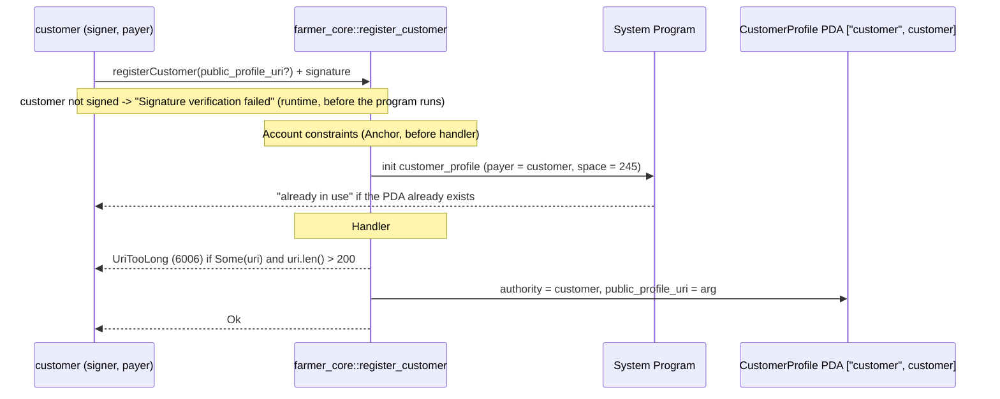

# register_customer

## Purpose

A customer signs with their own wallet and creates a `CustomerProfile` PDA keyed by that wallet, optionally storing a bounded public profile URI. It implements README.md section 8.3 (`register_customer(public_profile_uri?)`) and section 5.4 (`CustomerProfile`). Warehouse eligibility is not part of this step: it is the separate `WarehouseCustomer` confirmation flow (M2), as the `RegisterCustomer` doc comment states.

## Lifecycle

## Components

| Instruction | Signer | Accounts | Args | Events |
|---|---|---|---|---|
| `register_customer` | `customer` | `customer_profile` (init, PDA; client: auto from IDL), `customer` (signer + payer; client: `.accountsPartial({ customer })` + `.signers([customer])`), `system_program` (client: auto) | `public_profile_uri: Option<String>` | none (M1) |

Handler: `programs/farmer-core/src/instructions/register_customer.rs`. Wrapper: `register_customer` inside `#[program] mod farmer_core` in `programs/farmer-core/src/lib.rs`.

## Data model

Created: `CustomerProfile` (`programs/farmer-core/src/states.rs`)

| Field | Type | Set to |
|---|---|---|
| `authority` | `Pubkey` | `customer.key()` |
| `public_profile_uri` | `Option<String>` (`#[max_len(MAX_URI_LEN)]`, 200) | the arg, as given |

Seeds: `[SEED_CUSTOMER (b"customer"), customer.key()]`. Size: `8 + CustomerProfile::INIT_SPACE` = 245 bytes.

Reads no other account.

## Design decisions

- **PDA keyed by the signer's pubkey, not an explicit id.** One profile per wallet; the seed is the identity, so there is no id to pick and no counter (README 5.4, AGENTS.md "PDA Seeds").
- **Duplicate registration fails at `init`.** The second `init` on the same PDA is rejected by the system program ("already in use"); no handler code or `CustomerNotFound`-style check is needed.
- **The customer pays rent.** `payer = customer` keeps onboarding self-service: no admin or warehouse account is involved.
- **Only arg bounds are checked in the handler.** The sole `require!` enforces `MAX_URI_LEN` on the URI when present, per AGENTS.md "Error Handling" (gates in constraints, `require!` for arg bounds).
- **URI is `Option<String>`.** README 5.4 marks it optional; `None` is stored as `None` (tested by "accepts a missing uri"), so the client never has to invent a placeholder.
- **No config/pause gate.** AGENTS.md reserves the `!config.paused` constraint for market instructions; onboarding does not read `config`.

## Source

- `programs/farmer-core/src/instructions/register_customer.rs`
- `programs/farmer-core/src/states.rs`
- `programs/farmer-core/src/errors.rs`
- `programs/farmer-core/src/lib.rs`
- `tests/register_customer.ts`
- `tests/helpers.ts`
