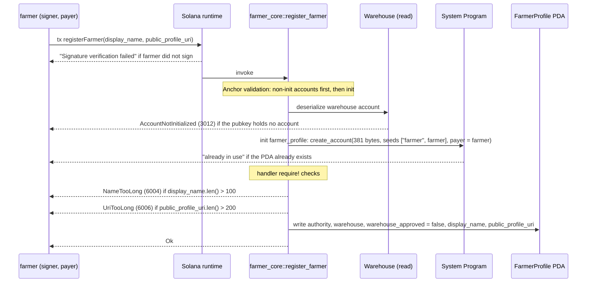

# register_farmer

## Purpose

A farmer signs and pays to create their own `FarmerProfile` PDA, naming the `Warehouse` they want to sell through. The profile is stored with `warehouse_approved = false`: this is the *request* half of README.md section 8.2 ("Farmer onboarding"). The warehouse operator grants the *approval* later with `set_farmer_warehouse`. No other program account is written.

## Lifecycle

## Components

| instruction | signer | accounts (name, role, how the client provides it) | args | events |
|---|---|---|---|---|
| `register_farmer` | `farmer` (also pays rent) | `farmer_profile`: init, PDA `["farmer", farmer]`, auto-resolved from `farmer`. `warehouse`: read-only `Account<Warehouse>`, must be passed (no seeds in the IDL). `farmer`: `Signer`, `mut`, passed via `accountsPartial` + `signers`. `system_program`: auto. | `display_name: String`, `public_profile_uri: String` | none (M1) |

Handler: `programs/farmer-core/src/instructions/register_farmer.rs`; wrapper `farmer_core::register_farmer` in `programs/farmer-core/src/lib.rs`.

## Data model

Created: `FarmerProfile` (`programs/farmer-core/src/states.rs`)

- `authority: Pubkey`: the farmer signer
- `warehouse: Pubkey`: address of the requested warehouse
- `warehouse_approved: bool`: always `false` here; set to `true` by `set_farmer_warehouse`
- `display_name: String`: max 100 bytes (`MAX_NAME_LEN`)
- `public_profile_uri: String`: max 200 bytes (`MAX_URI_LEN`)

Seeds: `[SEED_FARMER (b"farmer"), farmer.key()]`. Size: 8 + INIT_SPACE = 381 bytes (8 + 32 + 32 + 1 + (4 + 100) + (4 + 200)).

Read: `Warehouse`, only its existence and type are verified by `Account<'info, Warehouse>`; no field is read. `ProgramConfig` is not an account of this instruction.

## Design decisions

- **One profile per farmer key (singleton PDA per signer).** Seeds are `["farmer", farmer]`, so a wallet registers once; a second call fails at `init` with "already in use". No update instruction exists in M1.
- **Request, not approval.** The handler hard-codes `warehouse_approved = false`; the caller cannot pass it. Approval is `set_farmer_warehouse`, which requires `warehouse.operator` to sign and checks `farmer_profile.warehouse == warehouse` (`WarehouseMismatch`). This is the two-step flow in README section 8.2.
- **Warehouse by address, validated by type only.** The IDL has no seeds for `warehouse` (its id is not an arg), so the client passes the pubkey. `Account<'info, Warehouse>` rejects a missing account (`AccountNotInitialized`); any existing warehouse may be requested, the operator decides.
- **No pause / config gate.** AGENTS.md puts the `ProgramPaused` constraint on market instructions; onboarding is not one, so `config` is not loaded.
- **Gates as constraints, bounds via `require!`.** Signer, PDA uniqueness and warehouse existence are `#[account]` constraints; only the two string lengths are checked in the handler (AGENTS.md "Error Handling").
- **Farmer pays.** `payer = farmer`, hence `#[account(mut)]` on the signer; the admin is not involved.

## Source

- `programs/farmer-core/src/instructions/register_farmer.rs`
- `programs/farmer-core/src/states.rs`
- `programs/farmer-core/src/errors.rs`
- `programs/farmer-core/src/lib.rs`
- `tests/register_farmer.ts`
- `tests/helpers.ts`
