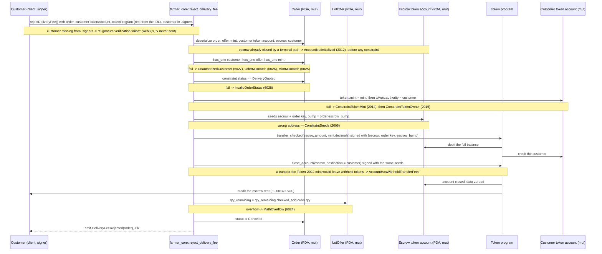

# reject_delivery_fee

## Purpose

The order's customer signs to turn down a quoted delivery fee. The instruction refunds the escrow's whole balance
(the subtotal deposited at `create_order`) to a token account the customer owns, closes the emptied escrow token
account and sends its rent back to the customer, restores `offer.qty_remaining` by `order.qty`, sets
`status = Canceled` and emits `DeliveryFeeRejected`. It implements README.md section 8.5
"Customer rejects delivery fee" (signer: customer; requires `status == DELIVERY_QUOTED`; refund escrow subtotal;
restore stock; status → `CANCELED`) plus the terminal-path rule of section 8.7 (every terminal path closes the escrow
and returns its rent to the customer, who paid it at `create_order`), the section 6 rule that the customer may cancel
only in safe pre-transit stages (reject quote at `DELIVERY_QUOTED`) and the "reject (cancel/refund)" branch of the
dynamic quote in section 7, on the `Order` + escrow token account of section 5.8.

## Lifecycle

All gates are `#[account]` constraints; the handler has no `require!`. Both token CPIs run before the two state
writes, inside the same transaction, so nothing changes unless the refund lands and the escrow closes.

## Components

| Instruction | Signer | Accounts (name, role, client resolution) | Args | Events |
|---|---|---|---|---|
| `reject_delivery_fee` | `customer` (the `order.customer` wallet; `mut`, receives the escrow rent) | `order` (mut, carries every gate, status written; must pass), `offer` (mut, stock restored; relation of `order`), `mint` (read, `decimals` for `transfer_checked`; relation of `order`), `customer_token_account` (mut, refund destination; must pass), `escrow` (mut, refund source, closed at the end; `pda` in the IDL, seeds from `order`), `customer` (mut signer, also the rent destination; relation of `order`, still needs `.signers`), `token_program` (interface, no fixed address; must pass `TOKEN_PROGRAM_ID`) | none | `DeliveryFeeRejected { order }` |

Only `order`, `customer_token_account` and `token_program` have to be passed: the Anchor TS client resolves `offer`,
`mint` and `customer` from the fetched `order` (`relations: ["order"]`) and `escrow` from its IDL seeds; the
`customer` keypair still goes in `.signers`. `tests/reject_delivery_fee.ts` passes the related accounts explicitly
through `.accountsPartial`, to be able to build the wrong-customer and wrong-offer cases.

Handler: `programs/farmer-core/src/instructions/reject_delivery_fee.rs`; token CPIs: `escrow::withdraw` and
`escrow::close` in `programs/farmer-core/src/escrow.rs`; wrapper: `farmer_core::reject_delivery_fee` in
`programs/farmer-core/src/lib.rs`.

## Data model

Mutated: `Order` (seeds `["order", offer, customer, order_id u64 LE]`, 8 + INIT_SPACE = 227 bytes). Only `status`
changes: `DeliveryQuoted` → `Canceled`. `expires_at` keeps the value set by `quote_delivery_fee` (now + 6 h at quote
time): no new window, `Canceled` is terminal. `delivery_fee_minor` keeps the quoted amount, which was never escrowed.

Mutated: `LotOffer` (seeds `["offer", farmer, offer_id u64 LE]`, 895 bytes): `qty_remaining += order.qty`, undoing
the reservation made at `create_order`.

Token balances: `escrow.amount` moves from the escrow token account (PDA `["escrow", order]`, plain SPL token
account of 165 bytes, its own authority) to `customer_token_account`. At `DeliveryQuoted` that balance is exactly
`subtotal_minor`. The emptied escrow is then closed: its ~0.00149 SOL of rent, paid by the customer at `create_order`
(`payer = customer` on the `init`), goes back to the `customer` account, and the PDA stops existing. The `Order` PDA
is not closed; its own rent stays locked in the `Canceled` record. The test asserts the buyer's token balance returns
to the pre-order value, `escrowClosed(order)` (no account info at the PDA), `qty_remaining` back to the pre-order
stock and `status == { canceled: {} }`.

Read: `Mint` (`decimals`), `order.escrow_bump` (signing seed for both CPIs), `order.qty`. Not touched:
`ProgramConfig` (no pause gate), `Warehouse`, `WarehouseCustomer`, `FarmerProfile`.

## Design decisions

- **Every gate is a constraint on `order`, in struct order:** `has_one = customer` (`UnauthorizedCustomer`),
  `has_one = offer` (`OfferMismatch`), `has_one = mint` (`MintMismatch`), `status == DeliveryQuoted`
  (`InvalidOrderStatus`) (AGENTS.md "Gates as constraints"). The test triggers the first, second and fourth.
- **Refund `escrow.amount`, not `order.subtotal_minor`.** AGENTS.md `escrow.rs` rule: refunds move the real balance,
  so the escrow is drained to exactly 0 whatever happened before — which is also what `close_account` requires.
- **The program signs with `[SEED_ESCROW, order, order.escrow_bump]`.** The escrow is its own authority and the bump
  is stored at creation, so no authority PDA and no re-derivation (README 5.8, `escrow_bump` comment in `states.rs`).
  The same seeds sign the withdrawal and the close.
- **Destination is any token account of the order's mint owned by the signer** (`token::mint = mint`,
  `token::authority = customer`), not necessarily the ATA used at `create_order`; `has_one = mint` on `order` stops a
  mint substitution.
- **Only `DeliveryQuoted` is accepted.** README 6 lets the customer cancel only at safe pre-transit stages and 8.5
  pins this instruction to `DELIVERY_QUOTED`. There is still no customer-signed exit from `PendingDeliveryQuote`:
  `refuse_delivery` is the operator's, `expire_order` (M6) is permissionless but only after `expires_at`, and the
  README's generic cancel has no instruction.
- **Mode is not checked** (no `NotDeliveryOrder`): only delivery orders reach `DeliveryQuoted`, since
  `quote_delivery_fee` requires `PendingDeliveryQuote`, which `create_order` sets only for `Delivery`.
- **Stock restored with `checked_add` → `MathOverflow`** (AGENTS.md "Checked arithmetic", README 12 "restore stock on
  any cancellation"). It cannot overflow in practice, every restored `qty` was subtracted first; the branch is untested.
- **No pause gate.** `config` is not loaded: a customer can still recover escrowed funds while `set_paused` blocks
  `publish_offer` and `create_order`.
- **`expires_at` is not checked.** This instruction never reads it; only `expire_order` does. A quote past its 6 h
  window (set by `quote_delivery_fee`) can still be rejected until someone expires the order, and whoever gets there
  first refunds the same escrow to the same customer.
- **Emits only `DeliveryFeeRejected { order }`** (README 9). `OrderCanceled` is listed there too, but no cancel
  instruction exists, so it is not emitted.
- **The escrow is closed and its rent returned (M6).** `escrow::close` runs right after the withdrawal, with the
  `customer` account as destination: the customer paid that rent at `create_order` (`payer = customer` on the escrow
  `init`), so it goes back to them. README 8.7 makes this the rule for all four terminal paths.
- **No new account was needed here, unlike the other three terminal paths.** The rent destination must be
  `order.customer`, and in this instruction the customer is already the signer, so the pubkey was in the struct from
  M4 — adding `mut` to `customer: Signer` was the whole account change, and `has_one = customer` was already the
  authorization gate. `refuse_delivery` and `complete_order` are signed by the operator and `expire_order` by nobody,
  so each had to gain a `customer: SystemAccount` field plus `has_one = customer @ UnauthorizedCustomer` to pin it.
- **A replay now fails on account resolution, not on the status gate.** With the escrow closed, a second
  `reject_delivery_fee` on the same order gets `AccountNotInitialized` (3012) while deserializing `escrow`, before
  Anchor evaluates `status == DeliveryQuoted`. The order is still `Canceled` and nothing moves; only the reported
  error changed. The status gate keeps answering whenever the escrow is alive: `tests/mark_in_transit.ts` "blocks
  refuse_delivery and reject_delivery_fee once in transit" gets `InvalidOrderStatus` on an `InTransit` order.
- **Token-2022 transfer-fee mints are incompatible with the close.** Such a mint withholds fees on the receiving
  account, so the escrow would hold less than the subtotal and `close_account` would fail with
  `AccountHasWithheldTransferFees`. The only control is `config.allowed_mints`, set once at `init_config`; the
  program does not inspect mint extensions (README 11).

## Source

- `programs/farmer-core/src/instructions/reject_delivery_fee.rs`
- `programs/farmer-core/src/escrow.rs`
- `programs/farmer-core/src/states.rs`
- `programs/farmer-core/src/errors.rs`
- `programs/farmer-core/src/events.rs`
- `programs/farmer-core/src/lib.rs`
- `tests/reject_delivery_fee.ts`
- `tests/mark_in_transit.ts` (status gate on an `InTransit` order, escrow still alive)
- `tests/helpers.ts`
