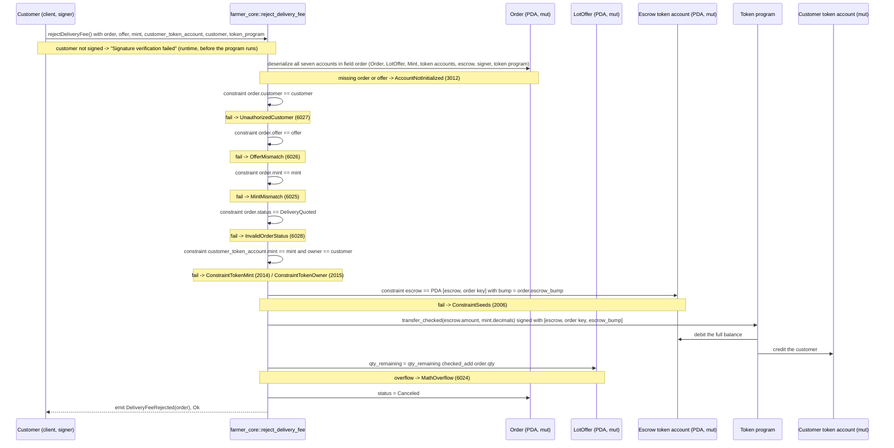

# reject_delivery_fee

## Purpose

The order's customer signs to turn down a quoted delivery fee. The instruction refunds the escrow's whole balance
(the subtotal deposited at `create_order`) to a token account the customer owns, restores `offer.qty_remaining` by
`order.qty`, sets `status = Canceled` and emits `DeliveryFeeRejected`. It implements README.md section 8.5
"Customer rejects delivery fee" (signer: customer; requires `status == DELIVERY_QUOTED`; refund escrow subtotal;
restore stock; status → `CANCELED`), the section 6 rule that the customer may cancel only in safe pre-transit
stages (reject quote at `DELIVERY_QUOTED`) and the "reject (cancel/refund)" branch of the dynamic quote in section 7,
on the `Order` + escrow token account of section 5.8.

## Lifecycle

All gates are `#[account]` constraints; the handler has no `require!`. The token CPI runs before the two state
writes, inside the same transaction, so nothing changes unless the refund lands.

## Components

| Instruction | Signer | Accounts (name, role, client resolution) | Args | Events |
|---|---|---|---|---|
| `reject_delivery_fee` | `customer` (wallet; pays no rent) | `order` (mut, carries every gate, status written; must pass), `offer` (mut, stock restored; must pass, IDL relation of `order`), `mint` (read, `decimals` for `transfer_checked`; must pass, relation of `order`), `customer_token_account` (mut, refund destination; must pass), `escrow` (mut, refund source; auto from IDL, seeds from `order`), `customer` (signer; must pass via `.accountsPartial` + `.signers`), `token_program` (interface, no fixed address; must pass `TOKEN_PROGRAM_ID`) | none | `DeliveryFeeRejected { order }` |

Handler: `programs/farmer-core/src/instructions/reject_delivery_fee.rs`; token CPI: `escrow::withdraw` in
`programs/farmer-core/src/escrow.rs`; wrapper: `farmer_core::reject_delivery_fee` in `programs/farmer-core/src/lib.rs`.

## Data model

Mutated: `Order` (seeds `["order", offer, customer, order_id u64 LE]`, 8 + INIT_SPACE = 227 bytes). Only `status`
changes: `DeliveryQuoted` → `Canceled`. `expires_at` keeps the value set by `quote_delivery_fee` (now + 6 h at quote
time): no new window, `Canceled` is terminal. `delivery_fee_minor` keeps the quoted amount, which was never escrowed.

Mutated: `LotOffer` (seeds `["offer", farmer, offer_id u64 LE]`, 895 bytes): `qty_remaining += order.qty`, undoing
the reservation made at `create_order`.

Token balances: `escrow.amount` moves from the escrow token account (PDA `["escrow", order]`, plain SPL token
account of 165 bytes, its own authority) to `customer_token_account`. At `DeliveryQuoted` that balance is exactly
`subtotal_minor`; the escrow ends at 0 and stays open: its rent, paid by the customer at `create_order`, is not
reclaimed in M4. The test asserts the buyer's balance returns to the pre-order value, the escrow holds 0 and
`qty_remaining` is back to the pre-order stock.

Read: `Mint` (`decimals`), `order.escrow_bump` (signing seed), `order.qty`. Not touched: `ProgramConfig` (no pause
gate), `Warehouse`, `WarehouseCustomer`, `FarmerProfile`.

## Design decisions

- **Every gate is a constraint on `order`, in struct order:** `has_one = customer` (`UnauthorizedCustomer`),
  `has_one = offer` (`OfferMismatch`), `has_one = mint` (`MintMismatch`), `status == DeliveryQuoted`
  (`InvalidOrderStatus`) (AGENTS.md "Gates as constraints"). The test triggers the first, second and fourth.
- **Refund `escrow.amount`, not `order.subtotal_minor`.** AGENTS.md `escrow.rs` rule: refunds move the real balance,
  so the escrow is drained to exactly 0 whatever happened before.
- **The program signs with `[SEED_ESCROW, order, order.escrow_bump]`.** The escrow is its own authority and the bump
  is stored at creation, so no authority PDA and no re-derivation (README 5.8, `escrow_bump` comment in `states.rs`).
- **Destination is any token account of the order's mint owned by the signer** (`token::mint = mint`,
  `token::authority = customer`), not necessarily the ATA used at `create_order`; `has_one = mint` on `order` stops a
  mint substitution.
- **Only `DeliveryQuoted` is accepted.** README 6 lets the customer cancel only at safe pre-transit stages and 8.5
  pins this instruction to `DELIVERY_QUOTED`. There is no customer-side exit from `PendingDeliveryQuote` in M4:
  `refuse_delivery` is the operator's, `expire_order` lands in M6, and the README's generic cancel has no instruction.
- **Mode is not checked** (no `NotDeliveryOrder`): only delivery orders reach `DeliveryQuoted`, since
  `quote_delivery_fee` requires `PendingDeliveryQuote`, which `create_order` sets only for `Delivery`.
- **Stock restored with `checked_add` → `MathOverflow`** (AGENTS.md "Checked arithmetic", README 12 "restore stock on
  any cancellation"). It cannot overflow in practice, every restored `qty` was subtracted first; the branch is untested.
- **No pause gate.** `config` is not loaded: a customer can still recover escrowed funds while `set_paused` blocks
  `publish_offer` and `create_order`.
- **`expires_at` is not checked.** No transition reads it; only `expire_order` (M6) will. A quote past its 6 h window
  can still be rejected until someone expires the order.
- **Emits only `DeliveryFeeRejected { order }`** (README 9). `OrderCanceled` is listed there too, but no cancel
  instruction exists, so it is not emitted.
- **No escrow close in M4.** The emptied token account stays; reclaiming its rent is deferred.

## Source

- `programs/farmer-core/src/instructions/reject_delivery_fee.rs`
- `programs/farmer-core/src/escrow.rs`
- `programs/farmer-core/src/states.rs`
- `programs/farmer-core/src/errors.rs`
- `programs/farmer-core/src/events.rs`
- `programs/farmer-core/src/lib.rs`
- `tests/reject_delivery_fee.ts`
- `tests/helpers.ts`
- `tests/flow_order.ts` (does not call this instruction; the flow goes through `accept_delivery_fee`)
