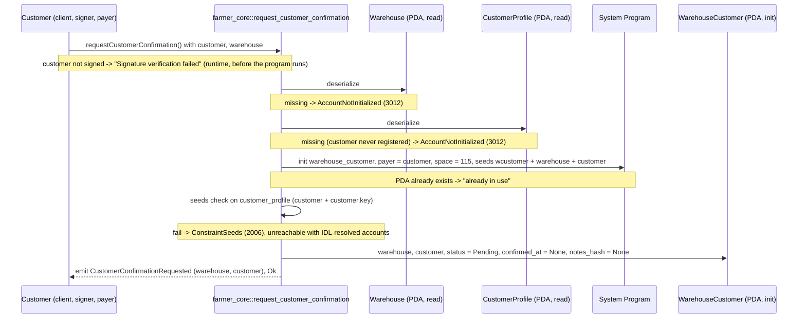

# request_customer_confirmation

## Purpose

A registered customer signs to ask a warehouse to confirm them. The call creates the
`WarehouseCustomer` PDA for the (warehouse, customer) pair with `status = Pending`, no
`confirmed_at` and no `notes_hash`, and emits `CustomerConfirmationRequested`. It is step 1 of the
README.md section 8.3 confirmation flow (signer: customer; README says "creates/sets `WarehouseCustomer =
PENDING`" and takes `warehouse` as an argument; this implementation only creates, takes no arguments and
receives the warehouse as an account) and creates the section 5.5 account. The address exchange itself
happens off-chain (README 3.1); the operator later moves the relation to `Confirmed` with `confirm_customer`.

## Lifecycle

There are no `require!` checks and no `FarmerCoreError` variant on this path: the handler is five
field writes plus the `emit!`. Every gate is an account check run by Anchor before the handler.

## Components

| Instruction | Signer | Accounts (name, role, client resolution) | Args | Events |
|---|---|---|---|---|
| `request_customer_confirmation` | `customer` (also payer) | `warehouse_customer` (init, PDA `["wcustomer", warehouse, customer]`; auto from IDL), `warehouse` (read, the warehouse being asked; must pass), `customer_profile` (read, PDA `["customer", customer]`, proves registration; auto from IDL), `customer` (signer + payer, mut; must pass via `.accountsPartial` + `.signers`), `system_program` (auto from IDL) | none | `CustomerConfirmationRequested { warehouse, customer }` |

Handler: `programs/farmer-core/src/instructions/request_customer_confirmation.rs`; wrapper:
`farmer_core::request_customer_confirmation` in `programs/farmer-core/src/lib.rs`.

## Data model

Created: `WarehouseCustomer` (seeds `["wcustomer", warehouse_pubkey, customer_pubkey]`,
8 + INIT_SPACE = 115 bytes).

| Field | Type | Set to |
|---|---|---|
| `warehouse` | `Pubkey` | `warehouse.key()` |
| `customer` | `Pubkey` | `customer.key()` |
| `status` | `WarehouseCustomerStatus` | `Pending` |
| `confirmed_at` | `Option<i64>` | `None` |
| `notes_hash` | `Option<[u8; 32]>` | `None` |

Transition performed: (no account) -> `Pending`. This is the only instruction that creates the
account, and `init` means it runs once per pair. Later transitions belong to other instructions:
`confirm_customer` (Pending or Revoked -> Confirmed, stamps `confirmed_at` and `notes_hash`) and
`revoke_customer` (Pending or Confirmed -> Revoked). There is no path back to `Pending`.

Read: `Warehouse` (seeds `["warehouse", warehouse_id u64 LE]`, 1367 bytes) for its key only;
`CustomerProfile` (seeds `["customer", customer]`, 245 bytes) for its existence only, no field is read.

Not touched: `ProgramConfig`. No pause or admin gate.

## Design decisions

- **`init` is the uniqueness check.** One PDA per (warehouse, customer) pair; a second request
  fails at the system program with "already in use" (test "rejects a second request for the same
  pair"). No "already requested" error variant and no handler check (AGENTS.md "PDA Seeds": a
  duplicate fails at `init`).
- **`customer_profile` is the registration gate, seed-bound to the signer.** The handler never
  reads it; requiring it with `seeds = [SEED_CUSTOMER, customer.key()]` is what proves the signer
  completed `register_customer` (README 8.3 lists it before the confirmation flow). An unregistered
  wallet gets `AccountNotInitialized`; `CustomerNotFound` (6012) stays defined in `errors.rs` for
  later use and is not raised here.
- **The customer pays and initiates.** `payer = customer` keeps the request self-service. The
  operator is not an account here: their part is the off-chain address collection (README 3.1)
  followed by `confirm_customer`.
- **`warehouse` is passed by address, not re-derived.** Its seed is `warehouse_id`, which is not an
  input; the `Account<Warehouse>` type check (owner + discriminator) is enough, and its key becomes
  part of the `warehouse_customer` seeds, so the pair is bound on-chain.
- **No re-request after revocation.** Because the account is `init`-only, a revoked customer cannot
  recreate it as `Pending`; re-admission is the operator's `confirm_customer` (Revoked -> Confirmed,
  see the `lib.rs` doc comment "also re-admits a revoked one"). `Revoked` is sticky from the
  customer's side.
- **Event after the writes.** `emit!(CustomerConfirmationRequested)` follows the state writes
  (AGENTS.md "events.rs"); the payload `{ warehouse, customer }` matches README section 9.
- **No `ProgramConfig` dependency.** Onboarding, not market: AGENTS.md reserves the
  `!config.paused` gate for market instructions.

## Source

- `programs/farmer-core/src/instructions/request_customer_confirmation.rs`
- `programs/farmer-core/src/states.rs`
- `programs/farmer-core/src/errors.rs`
- `programs/farmer-core/src/events.rs`
- `programs/farmer-core/src/lib.rs`
- `tests/request_customer_confirmation.ts`
- `tests/helpers.ts`
