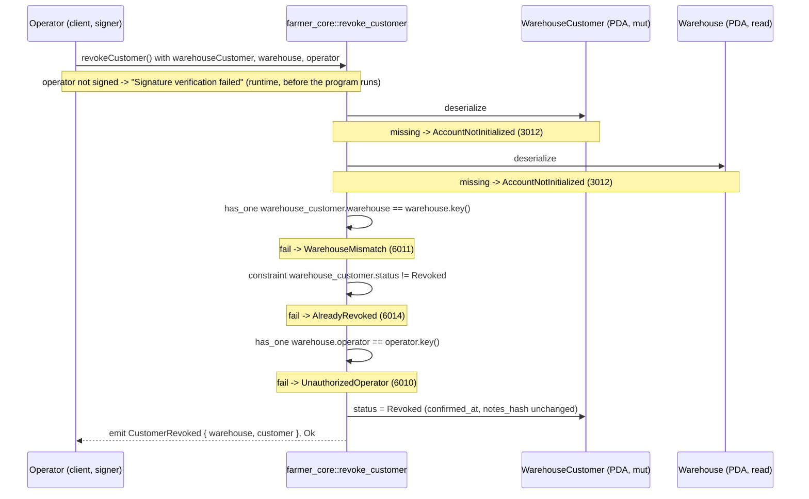

# revoke_customer

## Purpose

The warehouse operator signs to revoke a customer's relation with the warehouse. It moves the
`WarehouseCustomer` PDA from `Pending` (a denial of the request) or `Confirmed` (a withdrawal of
eligibility) to `Revoked`, leaves `confirmed_at` and `notes_hash` untouched as history, and emits
`CustomerRevoked`. It implements step 3 of the confirmation flow in README.md section 8.3
(signer: `warehouse.operator`; sets `REVOKED`) on the `WarehouseCustomer` account of section 5.5.
Because README's ordering eligibility rule requires `status == CONFIRMED`, a revoked customer can no
longer order from this warehouse until `confirm_customer` re-admits them. The call takes no arguments.

## Lifecycle

There are no `require!` checks: the handler body is one assignment plus the `emit!`. All gates
are account constraints, evaluated in struct field order.

## Components

| Instruction | Signer | Accounts (name, role, client resolution) | Args | Events |
|---|---|---|---|---|
| `revoke_customer` | `operator` (must equal `warehouse.operator`) | `warehouse_customer` (mut, the relation being revoked; must pass `wcustomerPDA(warehouse, customer)`), `warehouse` (read, owner of the relation; must pass), `operator` (signer; must pass + `.signers`) | none | `CustomerRevoked { warehouse, customer }` |

Handler: `programs/farmer-core/src/instructions/revoke_customer.rs`; wrapper:
`farmer_core::revoke_customer` in `programs/farmer-core/src/lib.rs`.

## Data model

Mutated: `WarehouseCustomer` (seeds `["wcustomer", warehouse_pubkey, customer_pubkey]`,
8 + INIT_SPACE = 115 bytes). Fields: `warehouse`, `customer`, `status: WarehouseCustomerStatus`
(`Pending | Confirmed | Revoked`), `confirmed_at: Option<i64>`, `notes_hash: Option<[u8; 32]>`.
Only `status` changes: `Pending -> Revoked` or `Confirmed -> Revoked`; `Revoked -> Revoked` is
blocked by `AlreadyRevoked`. Created by `request_customer_confirmation`; the reverse transition
(`Revoked -> Confirmed`) is `confirm_customer`.

Read: `Warehouse` (seeds `["warehouse", warehouse_id u64 LE]`, 8 + INIT_SPACE = 1367 bytes), used
for its `operator` field (via `has_one`) and its key (compared with `warehouse_customer.warehouse`).

Not touched: `ProgramConfig`, `CustomerProfile`. No pause or admin gate.

## Design decisions

- **Gates as constraints, minimal handler.** `WarehouseMismatch`, `AlreadyRevoked` and
  `UnauthorizedOperator` are `#[account]` constraints next to the account they protect
  (AGENTS.md "Gates as constraints"); the handler only writes `status` and emits.
- **Not idempotent.** Unlike `set_farmer_warehouse`, this instruction emits an event, so a repeat
  is rejected with `AlreadyRevoked` rather than silently re-emitting `CustomerRevoked` to the
  indexer. Verified by the "rejects an already revoked customer" test.
- **History is preserved.** `confirmed_at` and `notes_hash` are not cleared (doc comment on the
  struct); the test asserts `confirmedAt` is still set after revoking a confirmed customer. After
  creation only `confirm_customer` writes them (first confirmation or re-admission).
- **Revoking `Pending` is the denial path.** There is one PDA per warehouse+customer pair and no
  re-request, so a denied customer stays `Revoked` until the operator calls `confirm_customer`.
- **No args.** README 8.3 writes `revoke_customer(warehouse, customer)`; both arrive as the
  `warehouse` account and the stored `wc.customer`, and the event is built from `wc.warehouse` /
  `wc.customer`, not from the passed accounts.
- **`warehouse_customer` is not re-derived from seeds.** Its seeds include the customer key, which
  is not an account here; `has_one = warehouse` plus the account type check (owner and
  discriminator) are sufficient, and the client passes the address.
- **`WarehouseMismatch` is reused** for the `has_one = warehouse` gate instead of a new customer
  variant (AGENTS.md: reuse generic variants across entities); its `#[msg]` still reads
  "Farmer did not request this warehouse".
- **No `ProgramConfig` dependency.** Revocation is a per-warehouse decision; no admin or pause
  flag is consulted (no M2 instruction has a paused gate).

## Source

- `programs/farmer-core/src/instructions/revoke_customer.rs`
- `programs/farmer-core/src/states.rs`
- `programs/farmer-core/src/errors.rs`
- `programs/farmer-core/src/events.rs`
- `programs/farmer-core/src/lib.rs`
- `tests/revoke_customer.ts`
- `tests/helpers.ts`
