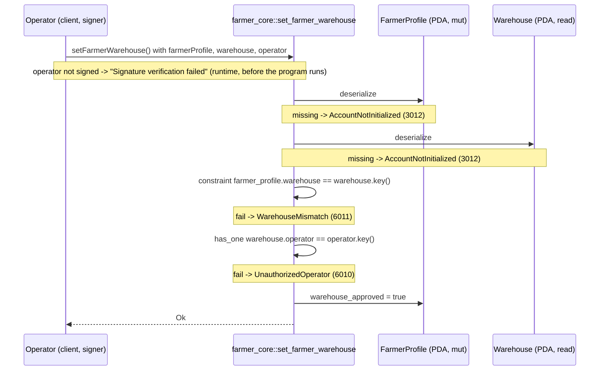

# set_farmer_warehouse

## Purpose

The warehouse operator signs to approve a farmer's join request. `register_farmer` creates the
`FarmerProfile` with `warehouse` set and `warehouse_approved = false` (the request); this
instruction flips `warehouse_approved` to `true` (the approval). It implements README.md
section 8.2 (signer: `warehouse.operator` of `farmer.warehouse`; sets `warehouse_approved = true`)
and the `FarmerProfile.warehouse_approved` rule in section 5.3 (required to publish offers).
The call is idempotent and takes no arguments.

## Lifecycle

There are no `require!` checks: the handler body is a single assignment. All gates are account
constraints, evaluated in struct field order.

## Components

| Instruction | Signer | Accounts (name, role, client resolution) | Args | Events |
|---|---|---|---|---|
| `set_farmer_warehouse` | `operator` (must equal `warehouse.operator`) | `farmer_profile` (mut, the profile being approved; must pass), `warehouse` (read, the requested warehouse; must pass), `operator` (signer; must pass + `.signers`) | none | none |

Handler: `programs/farmer-core/src/instructions/set_farmer_warehouse.rs`; wrapper:
`farmer_core::set_farmer_warehouse` in `programs/farmer-core/src/lib.rs`.

## Data model

Mutated: `FarmerProfile` (seeds `["farmer", farmer_pubkey]`, 8 + INIT_SPACE = 381 bytes).
Only `warehouse_approved: bool` changes; `authority`, `warehouse`, `display_name`,
`public_profile_uri` are untouched.

Read: `Warehouse` (seeds `["warehouse", warehouse_id u64 LE]`, 8 + INIT_SPACE = 1367 bytes).
Used for its `operator` field (via `has_one`) and its key (compared with `farmer_profile.warehouse`).

Not touched: `ProgramConfig`. This instruction has no pause or admin gate.

## Design decisions

- **Gates as constraints, empty handler.** `WarehouseMismatch` and `UnauthorizedOperator` are
  `#[account]` constraints, so each error is declared next to the account it protects
  (AGENTS.md "Gates as constraints").
- **Idempotent.** Setting a bool to `true` twice is harmless, so there is no "already approved"
  error; a retried transaction cannot fail spuriously. Verified by the `is idempotent` test.
- **No args.** The warehouse to approve is the one stored in `farmer_profile.warehouse` at
  registration; the operator cannot redirect a farmer to a different warehouse. The `warehouse`
  account is passed only so `has_one` can authorize the signer and the constraint can confirm
  the match.
- **`farmer_profile` is not re-derived from seeds.** Its seed is the farmer pubkey, which is not
  an account of this instruction; the mismatch constraint plus the account type check (owner and
  discriminator) are sufficient, and the client passes the address.
- **No `ProgramConfig` dependency.** Approval is a per-warehouse decision; the operator does not
  need the admin or the pause flag, so the config PDA is not read.

## Source

- `programs/farmer-core/src/instructions/set_farmer_warehouse.rs`
- `programs/farmer-core/src/states.rs`
- `programs/farmer-core/src/errors.rs`
- `programs/farmer-core/src/lib.rs`
- `tests/set_farmer_warehouse.ts`
- `tests/helpers.ts`
