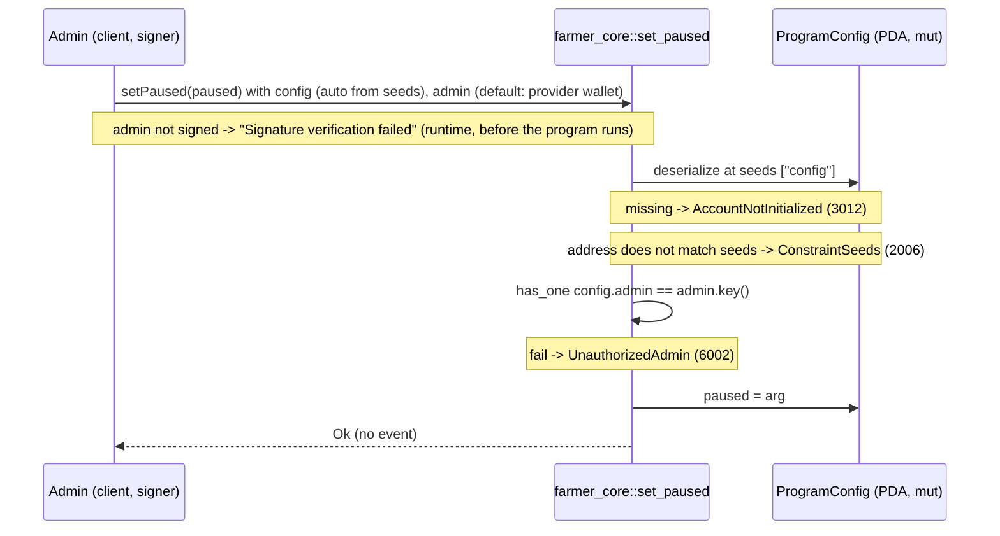

# set_paused

## Purpose

The program admin signs to set `config.paused` to an explicit `true` or `false`. It is the only writer of
that flag after `init_config` (README.md section 8.1) and therefore the operator switch behind the
"Program pause gate" of section 12: market instructions carry `constraint = !config.paused` and fail with
`ProgramPaused` while the flag is set. It was added in M3 because, without it, nothing could change
`paused` after creation, so the gate could never be exercised in tests or operated in production
(`docs/DEVELOPMENT_PLAN.md`, M3). Today the gate is carried by `publish_offer`; `deactivate_offer` is
deliberately exempt (a safety action must keep working while paused).

## Lifecycle

## Components

| Instruction | Signer | Accounts (name, role, client resolution) | Args | Events |
|---|---|---|---|---|
| `set_paused` | `admin` (must equal `config.admin`) | `config` (mut, the singleton being flipped; auto-resolved from const seeds `["config"]`), `admin` (signer; defaults to the provider wallet, override with `.accountsPartial({ admin })` + `.signers`) | `paused: bool` | none |

Handler: `programs/farmer-core/src/instructions/set_paused.rs`; wrapper: `farmer_core::set_paused` in
`programs/farmer-core/src/lib.rs`.

## Data model

Mutated: `ProgramConfig` (seeds `["config"]`, 8 + INIT_SPACE = 1037 bytes). Fields: `admin: Pubkey`,
`logistics_wallet: Pubkey`, `paused: bool`, `allowed_mints: Vec<Pubkey>` (max 30). This instruction writes
`paused` only; `admin` (read via `has_one`) and the other fields are untouched. Created once by `init_config`,
which also sets the initial `paused` value from its own argument.

Read: nothing else. No warehouse, farmer or offer account is involved.

Consumers of the flag: `publish_offer` (`constraint = !config.paused @ FarmerCoreError::ProgramPaused`).
`deactivate_offer` reads neither `config` nor `paused`.

## Design decisions

- **Dedicated instruction, not a generic `update_config`.** `paused` is the only config field that must
  change during operation in M3; `admin`, `logistics_wallet` and `allowed_mints` have no writer after
  `init_config` (`lib.rs` exposes no update instruction). README 8.1 names `set_paused(paused)` explicitly.
- **Gate as a `has_one` constraint, no `require!`.** `UnauthorizedAdmin` is declared on `config`
  (AGENTS.md "Gates as constraints"); the handler is `config.paused = paused`.
- **Explicit value, not a toggle; idempotent.** Setting the current value again succeeds. A retried or
  reordered transaction cannot flip the state the wrong way, and `tests/publish_offer.ts` can restore
  `false` in a `finally` block without reading the flag first.
- **No pause gate on itself.** The instruction must be callable while `paused == true`, otherwise the
  program could never be resumed.
- **No event.** README section 9 defines no config event and `events.rs` has none; the flag is readable
  from the account. Keeps the instruction to one write.
- **`config` re-derived from `seeds = [SEED_CONFIG]` + `bump`.** It is the singleton with constant seeds,
  so the IDL carries the PDA and the client never passes it; a wrong address fails at `ConstraintSeeds`
  before the admin check.
- **Shared singleton in tests.** `ProgramConfig` is created once by the root `before` in `tests/helpers.ts`
  and shared by every test file, so any test that pauses must unpause in `finally` or it breaks the suite.

## Source

- `programs/farmer-core/src/instructions/set_paused.rs`
- `programs/farmer-core/src/states.rs`
- `programs/farmer-core/src/errors.rs`
- `programs/farmer-core/src/lib.rs`
- `tests/set_paused.ts`
- `tests/helpers.ts`
