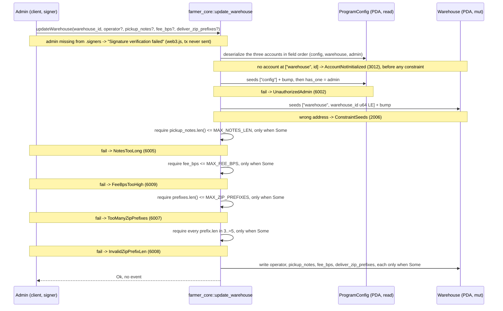

# update_warehouse

## Purpose

`config.admin` signs to patch a live `Warehouse`. The four patchable fields — `operator`,
`pickup_notes`, `fee_bps`, `deliver_zip_prefixes` — are each an `Option`, only the `Some` ones are
written, and an all-`None` call is a no-op. It implements README.md section 8.1
`update_warehouse(warehouse_id, operator?, pickup_notes?, fee_bps?, deliver_zip_prefixes?)` and reuses
`create_warehouse`'s bounds on exactly the fields it accepts (section 5.2 `Warehouse`). Nothing else
moves: no lamports, no token, no event, no pause gate, no new error variant.

It exists because of one otherwise unreachable escrow. README section 6 makes `IN_TRANSIT` mandatory
and `FULFILLED` reachable only from it, and the single instruction that reaches `FULFILLED` is
`complete_order`, gated by `order has_one = warehouse` plus `warehouse has_one = operator` — only the
warehouse operator can sign it (section 12: "operator must match order.warehouse.operator for ...
completion"). `expire_order` deliberately leaves `InTransit` out of its four accepted statuses,
`refuse_delivery` is pre-transit and delivery-only, and `reject_delivery_fee` is the customer's and
only from `DeliveryQuoted`. So an operator that loses its key strands that order's escrow forever, and
rotating `operator` is that escrow's only exit. The admin is therefore the last line of defence; the
residual is accepted and unmitigated: if the admin key is gone too, nothing recovers the funds, since
README section 14 defers the dispute flow to Phase 2.

## Lifecycle

The only authorization gate is the `#[account]` constraint `has_one = admin`; the four bounds are
handler `require!`s on the arguments, as AGENTS.md prescribes. Every `require!` runs before the first
write, so a patch that carries one bad field writes none of its good ones.

## Components

| Instruction | Signer | Accounts (name, role, client resolution) | Args | Events |
|---|---|---|---|---|
| `update_warehouse` | `admin` (must equal `config.admin`; **not** `mut` — nothing is created and no lamports move, unlike `create_warehouse` where the admin is the rent payer) | `config` (read, `has_one = admin` gate; IDL `pda`, seeds `b"config"`), `warehouse` (mut, the patched account; IDL `pda`, seeds `b"warehouse"` + the `warehouse_id` **argument**), `admin` (signer; IDL `relations: ["config"]`, resolved from the fetched `config.admin`, which is the provider wallet in tests and signs by itself — `.accountsPartial({ admin })` + `.signers([kp])` only to override it) | `warehouse_id: u64`, `operator: Option<Pubkey>`, `pickup_notes: Option<String>`, `fee_bps: Option<u16>`, `deliver_zip_prefixes: Option<Vec<ZipPrefix>>` | none |

Nothing has to be passed: the client resolves `config` from its constant seed, `warehouse` from the
`warehouse_id` argument it is already sending, and `admin` from the fetched `config` (`relations`).
`tests/update_warehouse.ts` passes `admin` through `.accountsPartial` only to build the non-admin case.
There is no `system_program`: no account is created.

Handler: `programs/farmer-core/src/instructions/update_warehouse.rs`; wrapper:
`farmer_core::update_warehouse` in `programs/farmer-core/src/lib.rs`, declared right after
`create_warehouse`.

## Data model

Mutated: `Warehouse` (seeds `["warehouse", warehouse_id.to_le_bytes()]`, 8 + INIT_SPACE = 1367 bytes).

| Field | Patchable | Bound when `Some` | Error |
|---|---|---|---|
| `warehouse_id` | no | — | it is the seed; changing it would be a different PDA |
| `operator` | yes | none: any `Pubkey`, no account required for it | — |
| `name` | no | — | README 8.1 does not list it |
| `pickup_notes` | yes | `MAX_NOTES_LEN` = 500 bytes | `NotesTooLong` (6005) |
| `fee_bps` | yes | `MAX_FEE_BPS` = 10_000 | `FeeBpsTooHigh` (6009) |
| `delivery_fee_rules_uri` | no | — | README 8.1 does not list it |
| `deliver_zip_prefixes` | yes | `MAX_ZIP_PREFIXES` = 100 items, every `len` in `3..=5` | `TooManyZipPrefixes` (6007), `InvalidZipPrefixLen` (6008) |

Read: `ProgramConfig` for `admin`. Not touched: `Order`, `LotOffer`, the escrow token accounts,
`WarehouseCustomer`, `FarmerProfile`, `CustomerProfile`. The account never changes size: `InitSpace`
reserved the maximum for `pickup_notes` and `deliver_zip_prefixes` at `create_warehouse`, so a longer
string or a fuller vector fits without a realloc.

## Design decisions

- **Admin signs, not the operator.** A key that is lost cannot sign its own rotation, so an
  operator-signed rotation would be useless in the one case that matters. `config has_one = admin @
  UnauthorizedAdmin` is the same gate `create_warehouse` and `set_paused` already use. Verified by
  "rejects a signer that is not config.admin".
- **The reason the instruction exists is an `InTransit` escrow.** That order can only be finished by
  `complete_order`, which the warehouse operator must sign, and `expire_order` excludes `InTransit` on
  purpose (the goods are moving and the warehouse owns the outcome). Rotating `operator` is that
  escrow's only exit, which is why the rotation is bundled into an admin instruction instead of waiting
  for a Phase 2 dispute flow. Verified end to end by "rotates the operator so a stuck in-transit order
  can still be completed": the order is marked in transit, the operator is rotated, the old operator's
  `complete_order` then fails with `UnauthorizedOperator` (6010) and the new one's succeeds.
- **`Option` per field, no sentinel values.** Only `Some` is written, so the client patches one field
  without reading and resending the rest, and no value is reserved to mean "unchanged" (`fee_bps = 0`
  and an empty prefix vector are both legitimate). An all-`None` call is consequently a valid no-op
  that costs a transaction fee and changes nothing: "keeps every field when no argument is given"
  asserts the fetched account deep-equals the one fetched before the call.
- **`name` and `delivery_fee_rules_uri` are deliberately not patchable.** README 8.1 lists neither in
  the signature and says outright that they "are not updatable"; the argument list mirrors
  `create_warehouse`'s minus those two, which keeps the two signatures readable side by side.
  `MAX_NAME_LEN` and `MAX_URI_LEN` therefore cannot be reached from here, and `NameTooLong` /
  `UriTooLong` are not among
  this instruction's errors. "patches only the fields given" asserts both survive a patch unchanged.
- **Validation is `create_warehouse`'s, re-run per present field.** Each bound is a handler `require!`
  guarded by the `Option`, so an absent field is never validated and a present one is validated
  exactly as it would be at creation. All four `require!`s precede all four writes, so a rejected
  patch leaves the account untouched.
- **A new `fee_bps` applies to future orders only.** `create_order` computes
  `service_fee_minor = subtotal_minor * warehouse.fee_bps / 10_000` once and stores it on the `Order`;
  `complete_order` pays out of that stored number and never re-reads the warehouse. So raising the fee
  cannot retroactively tax an escrow already funded — "does not change the service fee of an order
  already created" pushes `fee_bps` to 10_000 and asserts the existing order still carries
  `SERVICE_FEE` (250_000, from the fixture's 250 bps on a 10_000_000 subtotal).
- **No event, matching `create_warehouse`.** The warehouse lifecycle emits nothing in README section 9:
  there is no `WarehouseCreated`, so there is no `WarehouseUpdated` either, and indexers read the
  account. The rotation test asserts the emitted list is exactly `[]`.
- **No pause gate.** `config` carries only the `has_one`, not
  `constraint = !config.paused`: pausing the market must not also disable the escrow rescue this
  instruction exists for, and the admin instructions never gate on their own switch.

## Source

- `programs/farmer-core/src/instructions/update_warehouse.rs`
- `programs/farmer-core/src/instructions/create_warehouse.rs` (the bounds this one reuses)
- `programs/farmer-core/src/states.rs`
- `programs/farmer-core/src/errors.rs`
- `programs/farmer-core/src/lib.rs`
- `tests/update_warehouse.ts`
- `tests/helpers.ts`
